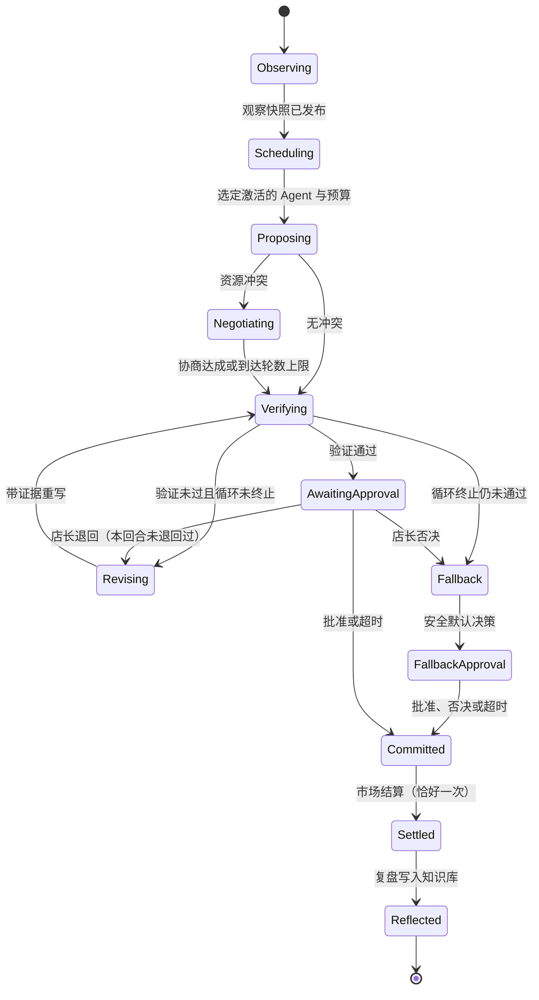

# 多 Agent 经营挑战：设计说明（待审阅）

状态：规划稿，未实现，未经用户批准。本文所有数值都标注为「目标」「配置」或「待测」，没有任何一项是测量结果。

日期：2026-11-08（Asia/Shanghai）。初赛提交截止 2026-11-20，官网接口时间 11/20 00:00，本计划按 11/19 完成全部准备。

## 0. 目标与本文范围

用户的目标：参加第五届「未来杯」赛题一「Agent 编排创新应用」，做一个可复用的多 Agent 编排、调度、执行、验证平台。演示场景是多个 Agent 合作经营一家虚拟小店，采购、定价、营销分工协作，遇到断供和竞品降价时重新协商，用可复现的市场模拟检验决策。

要解决的问题：赛题要求「平台级作品」，而经营场景很容易滑向两种失败。一种是做成纯游戏，平台能力被淹没。另一种是几个 Agent 轮流发言再硬编码拼结果，评委看不到调度、验证和循环的真实工作。

本文只做设计。不写应用代码，不部署，不公开仓库。

输入材料：

- `competition-details.txt`：官网接口取得的赛事原文，本文的赛题要求全部以它为准。
- `02-simshop-harness-mvp.md`：未经审阅的粗草案。本文吸收了它的角色划分，推翻了它的 Self-Loop 设计（见第 1 节）和部分技术选型（见第 4 节）。

## 1. 草案的「看到结果不好就回滚」是作弊，必须从结构上关掉

草案第 6 步写的是：MarketSim 跑一周得到指标，如果利润低于阈值或缺货率高于阈值，就回到第 2 步带着失败原因重新提案，最多 N 轮。这个循环在真实经营里不可能存在，因为真实的一周过去就过去了。具体漏洞如下。

| 编号 | 漏洞 | 后果 |
| --- | --- | --- |
| L1 | 结果窥视。固定种子时，同一周的需求噪声每次都一样，重试等于拿着已实现的未来去调参。 | 利润被系统性抬高，Agent 学到的是「答案」，不是决策能力。 |
| L2 | 不固定种子时，重试变成重掷骰子，取 N 次里最好的一次。 | 报告的利润是 N 次抽样的最大值，期望上偏高，与基线不可比。 |
| L3 | 动态策略比基线多拿了 N 倍结算机会和 LLM 调用。 | 「动态协作更强」的结论失效，因为预算不公平。 |
| L4 | 快照被当成存档读档使用。 | 账本可改写，审计和复现都失去意义。 |
| L5 | 草案允许 MarketSim 用「规则 + LLM」。 | LLM 可以编造销量和利润，数值不可复现也不可核查。 |
| L6 | Critic 是 LLM，可以「同意」任何东西。 | 库存、现金、价格底线这类硬约束如果只靠 Critic，就会漏。 |
| L7 | 预测工具若共用结算随机流，或读到未公开的事件时间表。 | 信息泄漏，沙盘预测等于偷看答案。 |
| L8 | 结算在崩溃后重试，可能重复扣现金、重复入库。 | 账本不一致，重放结果不同。 |

修复设计是把每个回合拆成两个阶段，中间隔一道不可逆的提交边界。

1. **沙盘阶段（可反复）**。Agent 提案、约束校验、沙盘预测、Critic 质询、修正，全部发生在这里。沙盘只读当前状态，用独立的预测随机流和「公开市场模型」（Agent 可观察到的参数估计，不是真实隐藏参数）。沙盘调用不改变任何持久状态，状态哈希在沙盘前后必须相同。
2. **提交（不可逆）**。决策包通过所有硬约束后，引擎计算决策哈希并写入 `DecisionCommitted` 事件。每个 `(runId, round)` 只能有一条提交。之后对同一回合提交不同决策，引擎返回冲突错误。
3. **结算（恰好一次，幂等）**。市场规则引擎用结算随机流计算结果，写入 `RoundSettled` 事件。结算的幂等键是 `(runId, round, decisionHash)`。崩溃后重跑得到逐字节相同的结果，已有结算记录时直接返回该记录。
4. **复盘（只影响未来）**。结算结果只能进入下一回合，形式是反思记忆和信念参数更新。已结算回合永不重做。

隐藏信息用类型隔离，而不只是约定「只读」：

- `ScenarioTruth`：真实市场参数、未来事件日程、结算流。只有结算函数能拿到。
- `Observation = project(State)`：Agent、工具、新闻生成、叙述用 LLM 能拿到的全部信息。
- `PublicModel`：沙盘用的公开参数估计。

不变量测试：扰动 `ScenarioTruth` 里的隐藏参数和未来回合事件，沙盘输出与 `Observation` 必须逐字节不变。知识库里的「供应商合同条款」只写公开条款，不写底价。

跨运行同样不能泄漏。知识库分成只读底库和按 `runId` 隔离的覆盖层，复盘经验只写覆盖层，开局断言覆盖层为空。调度权重、信念参数同理，按运行隔离。否则同一种子上后跑的策略会读到先跑策略的结算经验。

快照只用于两件事：崩溃恢复和审计重放。快照恢复后，下一步只能是继续未完成的步骤，不能重开已提交的回合。

工具按副作用分级，这是关掉 L1、L4、L7 的结构手段，而不是靠提示词约束：

- `read`：读当前可观察状态，例如库存、现金、历史成交、公开新闻。
- `sandbox`：沙盘预测、约束试算。只能读状态，用预测随机流。
- `commit`：只有引擎的提交节点能调用，Agent 的工具清单里根本没有这一类。

市场结果只由确定性规则计算（第 6.4 节）。LLM 在结算之后可以把结算数字写成「顾客评论」「周报」这类文字，但文字不回写任何数值。

为了让评委直观看到这个漏洞的代价，实验台保留一条明确标注为「作弊对照」的策略：它允许读结算结果后重做本回合。它只出现在对比图里作为上界参照，不参与任何正常运行。它比正常策略高出多少是待测数值。

## 2. 体验流程

体验的主角是平台在工作，玩家是「店长」兼「导演」。玩家不替 Agent 做决策，而是设目标、制造危机、在审批节点拍板，并在结束时看到同一种子下不同编排策略的对比。

### 2.1 一局的流程

1. **开局**。玩家选择场景（例如「春季开学季」）、种子、回合数（配置，默认 8 回合）、编排策略（固定串行、动态协作，P1 加单 Agent）。界面显示本局的模型、预算上限和种子，开局后不可修改。
2. **观察**。每回合开始时引擎发布观察快照：现金、库存、声誉、竞品公开价格、新闻。新闻里可能有事件预告，但只给公开信息。
3. **调度**。调度器根据本回合特征决定激活哪些 Agent、给多少调用预算。平静回合可能只激活定价和采购；有事件时会插入子工作流。玩家在工作流图上看到节点亮起、排队和并行。
4. **并行提案**。被激活的 Agent 并行产出结构化提案（JSON，带理由和引用的知识库条目）。
5. **预算协商**。采购、定价、营销都要用现金。提案冲突时进入协商。每个方案的「出价」取沙盘工具对该方案算出的边际收益，不取 Agent 自报的数字。调度器在现金约束下分配。协商轮数有上限（配置）。
6. **分层验证**。依次是 Schema 校验、硬约束（代码）、沙盘预测（p10、p50、p90 利润和缺货风险）、Critic 质询。Critic 的每条反对意见必须指向一个失败的检查项或一个沙盘数字，否则不计入。
7. **Self-Loop 修正**。验证不过时，失败原因回到对应 Agent，带着证据重写。循环有硬上限和多个终止条件（第 7 节）。
8. **店长审批**。玩家看到决策包、验证报告和沙盘区间，可以批准、退回、或否决。退回每回合最多一次，计入修正循环次数。否决直接采用安全默认决策。安全默认决策到审批时只能批准或否决，不能再退回。超时按配置自动批准或采用安全默认决策。实验台运行时审批节点固定为自动批准。
9. **提交与结算**。提交后界面显示锁定标记，市场引擎结算，账本追加一行。
10. **复盘**。复盘 Agent 对比沙盘预测和实际结果，写一条带证据指针的经验进知识库，并更新公开市场模型的信念参数。
11. **危机卡**。玩家在任意回合开始前可以打出一张危机卡，例如「主供应商断供 2 回合」「竞品降价 20%」「差评风波」。危机卡改变的是下一回合的市场规则输入，按种子确定性生效，并写入事件日志，所以可以重放。
12. **终局**。显示本局曲线，以及其他策略在同种子、同预算、同一份危机卡日志下的重放结果。玩家打过的危机卡改变了场景，所以对比必须用本局的危机卡日志重跑其他策略，不能拿无危机卡的离线结果比。实验台的正式数据用预先固定的危机卡日程。

### 2.2 两个让人想看下去的瞬间

- **断供协商**。主供应商断供后，调度器插入「供应协商」子工作流。采购 Agent 与两家备选供应商轮流报价。供应商的接受与还价由规则函数决定（隐藏底价、产能、交期、让步曲线），LLM 只为供应商生成谈判话术，话术不含底价，不影响成交价。这样进货成本仍完全由规则决定，与第 1 节「市场只由规则计算」一致。子工作流是带 `maxIterations` 的循环节点（配置，建议 3 轮），破裂时输出「本回合不向该供应商下单」。界面把每轮报价画成价格和交期的走势，玩家能看到讨价还价收敛或破裂。
- **价格战仲裁**。竞品降价时，定价想跟价，营销想加投放保价，采购想少进货保现金。三方的沙盘估算摆在一起，调度器按边际收益分配现金。玩家能看到「谁赢了这轮预算」和理由。

### 2.3 可选：同种子挑战（不进首个切片）

玩家亲自经营同一种子的一家店，与 Agent 团队比结果。它很有参与感，但需要一套人工操作界面，挤占平台工作量。放进「有余力再做」的清单，首个切片不做。

## 3. 赛题要求与本设计的对照

| 赛题要求（原文要点） | 本设计的落点 |
| --- | --- |
| Agent 团队定义与管理，角色、技能、工具集、记忆，动态注册、发现、版本 | `AgentSpec` 注册表，带版本号和能力画像；运行时按能力发现 |
| 工作流编排：顺序、并行、条件、循环、子工作流嵌套 | 声明式工作流定义，节点类型全覆盖；断供协商是嵌套子工作流 |
| 智能调度：任务特征、负载、依赖、优先级，至少一种 Self-Loop | 依赖就绪队列 + 能力画像与边际收益评分 + 预算分配；回合内修正循环和跨回合复盘循环 |
| 工具集成：MCP、Function Calling、API 插件 | Function Calling 为主；店铺情报工具以 MCP 服务器形式提供；工具按副作用分级 |
| 执行监控与结果验证：状态监控、中间结果捕获、异常检测、自动或人工验证、交叉验证、基准比对、置信度 | 事件日志全量捕获；分层验证；店长审批节点；沙盘区间作为置信度；实验台基准比对 |
| 反馈与自我优化：Prompt、工具选择、工作流路径自适应 | 复盘写入知识库并进入下一回合提示词；调度权重随结果更新；路径由调度器按状态选择 |
| 知识库定义与集成 | 经营手册、供应商合同条款、复盘经验，本地检索 |
| 执行日志、状态快照、结果校验与回滚，可追溯、可审计、可复现 | 事件溯源；快照用于恢复和重放；「回滚」只作用于未提交的沙盘状态，并在文档里写清这个限定 |
| 必须基于 LLM，编排要智能而非硬编码 | Agent 推理由 LLM 完成；调度决策可解释但不写死 |
| 开源框架可用，但调度、验证、循环要有自定义创新 | 编排内核自研；只用通用库（Schema 校验、LLM SDK、MCP SDK） |
| 决赛要并发、延迟、成功率等指标，与串行、单 Agent 基线对比 | 实验台从第一天按这个口径设计 |

赛题原文提到「回滚能力」。本设计的回滚有明确边界：未提交的沙盘状态可以丢弃重来，失败的步骤可以从快照恢复后重试；已提交的经营回合不可回滚。这个边界本身就是一个可讲的工程点。

## 4. 架构取舍

### 4.1 三个候选

**方案 A：在现成图编排框架上加自定义节点（例如 LangGraph）**

- 好处：图执行、检查点、流式输出现成；Python 生态成熟。
- 问题：调度、验证、循环的核心逻辑会落在框架的默认语义里，评委看到的是「框架示例加业务节点」，正好踩到赛题「禁止直接套用现成框架默认示例」的红线。框架检查点是为对话恢复设计的，要做「提交后不可逆、结算恰好一次」还得在外面再包一层。

**方案 B：自研事件溯源编排内核 + 声明式工作流 + 纯函数市场（推荐）**

- 核心是一张追加写的事件表，所有状态由事件折叠得到。调度器、执行器、验证器、循环控制器都是内核的一部分，用户能在界面上直接看到它们的决策事件。
- 好处：可复现和可审计是结构自带的；提交边界、幂等结算、重放都只是事件规则；调度和验证的创新点全部是自己的代码，好讲也好证明。
- 代价：执行器、重试、超时、并发要自己写。按本项目规模，这部分代码量可控，但它是关键路径。

**方案 C：LLM 主管动态路由（群聊式，类似 AutoGen GroupChat 的 speaker selection）**

- 好处：看起来最「智能」，代码最少。
- 问题：结果不可复现，验证点散落在对话里，最容易变成「几个 Agent 轮流聊天」。与用户明确不要的形态正面冲突。

### 4.2 推荐与理由

推荐方案 B。决定性理由有两条。第一，回滚漏洞的修复依赖「提交边界」和「工具副作用分级」，这两样在事件溯源内核里是一等公民，在 A 和 C 里都要额外包装。第二，赛题评的是编排调度层的工程能力，B 让调度、验证、循环全部成为可展示、可测试的自研代码。

方案 C 的「智能路由」并不浪费：调度器的一个可选策略可以让 LLM 给出候选激活集合，再由规则评分和预算约束裁决。这样保留了 LLM 的判断，又不把确定性交出去。

### 4.3 技术栈建议（非约束，待用户确认）

草案写的是 Python + FastAPI。我建议改为 TypeScript 单仓库，理由如下：

- 界面是实时工作流图和事件流，前后端共用同一套事件和领域类型，类型错误在编译期暴露。
- MCP 官方 SDK 和主流 LLM SDK 都有 TypeScript 版本。
- 市场模拟是整数运算的纯函数，不需要科学计算库。

建议组成（每项都可替换）：

- 运行时：Node 22，`pnpm`。
- 编排服务：Hono（长连接运行和 SSE 事件推送；运行是长生命周期进程，不适合请求级的 Route Handler）。
- 存储：SQLite（`better-sqlite3`），事件表和快照表。
- 界面：Vite + React + Tailwind + shadcn/ui，工作流图用 React Flow，曲线用 Recharts。
- 校验：Zod，同时生成 Function Calling 的 JSON Schema。
- 知识库检索：本地 BM25（例如 MiniSearch）。向量库不是必需，规模太小，不值得引入。
- LLM：OpenAI 兼容接口适配器（国产模型如 DeepSeek、通义千问都提供兼容接口），外加录制回放（cassette）和确定性 Mock 两种无密钥模式。
- 测试：Vitest（单元与属性测试），Playwright（真实界面）。

如果团队更熟 Python，方案 B 在 Python 下同样成立，只是前后端类型要维护两份。这是一个需要用户拍板的偏好问题。

## 5. 通用平台与经营模板的边界

判断标准：把「小店」换成任何别的多 Agent 任务，平台目录下的代码一行不改也能跑。

| 平台（`src/engine/**`，与场景无关） | 经营模板（`src/templates/simshop/**`） |
| --- | --- |
| Agent 注册表、版本、能力画像 | 采购、定价、营销、Critic、复盘、供应商谈判方的 `AgentSpec` 与提示词 |
| 工具注册表、副作用分级、Function Calling、MCP 客户端 | 店铺情报 MCP 服务器、库存查询、竞品价格、沙盘预测工具 |
| 工作流定义与执行（顺序、并行、条件、循环、子工作流、人工节点、验证节点、提交节点） | 每回合工作流、断供协商子工作流、价格战仲裁子工作流 |
| 调度器（就绪队列、评分、预算分配） | 回合特征提取函数（事件、库存压力、价差） |
| 验证管线（Schema、硬约束、沙盘、Critic）与 Self-Loop 控制器 | 具体约束（现金不为负、库存上限、价格底线、投放上限） |
| 事件日志、快照、重放、幂等提交 | 市场规则引擎（纯函数）、场景与危机卡 |
| 实验台（策略 × 种子 × 预算） | 评分函数（利润、缺货率、声誉） |
| 知识库与检索 | 经营手册、合同条款语料 |

边界用工具强制，而不是靠约定。建议在 lint 里加一条导入规则：`src/engine/**` 禁止导入 `src/templates/**`。另外放一个极小的第二模板（例如「会议排期」，两个 Agent、一个约束），只在测试里运行，用来证明平台不依赖小店概念。第二模板不进演示主线。

## 6. 核心数据形状

以下是类型草图，用来定边界，不是最终代码。金额全部用整数「分」，避免浮点在不同机器上产生差异。

### 6.1 Agent 与工具

```ts
type AgentSpec = {
	id: AgentId;
	version: SemVer;
	role: string;
	systemPrompt: PromptTemplateId;
	tools: ToolName[];
	memory: { kind: "none" | "window" | "kb"; window?: number };
	capabilities: Partial<Record<SkillTag, number>>; // 0..1 能力画像
	model: ModelRef;
	budget: { maxCallsPerRound: number; maxTokensPerRound: number };
};

type ToolEffect = "read" | "sandbox" | "commit";

type ToolSpec<I, O> = {
	name: ToolName;
	effect: ToolEffect;
	input: ZodSchema<I>;
	output: ZodSchema<O>;
	transport: { kind: "inproc" } | { kind: "mcp"; server: string };
};
```

注册时校验：任何 `AgentSpec.tools` 引用了 `effect: "commit"` 的工具，注册直接失败。

### 6.2 工作流

```ts
type WorkflowNode =
	| { kind: "agent"; id: NodeId; agent: AgentId; task: TaskTemplateId }
	| { kind: "tool"; id: NodeId; tool: ToolName }
	| { kind: "parallel"; id: NodeId; branches: NodeId[]; join: "all" | "any" | { quorum: number } }
	| { kind: "condition"; id: NodeId; predicate: PredicateId; then: NodeId; else: NodeId }
	| { kind: "loop"; id: NodeId; body: NodeId; until: PredicateId; maxIterations: number }
	| { kind: "subflow"; id: NodeId; workflow: WorkflowId }
	| { kind: "verify"; id: NodeId; pipeline: VerifierId[] }
	| { kind: "humanGate"; id: NodeId; timeoutMs: number; onTimeout: "approve" | "fallback" }
	| { kind: "commit"; id: NodeId };
```

`loop` 节点的 `maxIterations` 是必填项，所以不存在无界循环。条件和终止判断引用已注册的谓词 ID，不在定义里写任意代码。

### 6.3 事件与回合记录

```ts
type EngineEvent = {
	runId: RunId;
	seq: number;            // 每个 run 内严格递增
	type: EventType;        // RunStarted | NodeScheduled | AgentProposed | VerifyReported | LoopIterated | DecisionCommitted | RoundSettled | ...
	payload: unknown;       // 按 type 的判别联合
	causationId?: EventId;
	idempotencyKey?: string;
	actor?: { agent: `${AgentId}@${SemVer}`; promptHash: Hash }; // Agent 产生的事件必填，复现链靠它
};

type DecisionPackage = {
	orders: { sku: SkuId; supplier: SupplierId; qty: number; unitCostCents: number }[];
	prices: { sku: SkuId; priceCents: number }[];
	adSpendCents: number;
	promotions: { sku: SkuId; kind: PromoKind }[];
	provenance: Record<string, AgentId>; // 每个字段由哪个 Agent 提出
	rationale: { agent: AgentId; text: string; kbRefs: KbId[] }[];
};

type RoundRecord = {
	round: number;
	observationHash: Hash;
	decisionHash: Hash;
	outcome: Outcome;      // 销量、营收、成本、缺货、声誉变化，全部整数
	prevHash: Hash;
	beliefHash: Hash;      // 本回合结束后的公开模型参数
	kbOverlayHash: Hash;   // 本运行知识库覆盖层
	hash: Hash;            // hash(prevHash, round, observationHash, decisionHash, outcome, beliefHash, kbOverlayHash)
};
```

回合记录形成哈希链。重放后比较最终哈希，就能判断两次运行是否完全一致。

### 6.4 市场规则与随机流

随机流按用途派生，互不重叠。派生用哈希，即 `hash(seed, stream, round, sku, k)` 作为子种子，不用「种子加偏移」，避免两条流撞在一起：

- 结算流：`(seed, "settle", round, sku)`。只有市场引擎的结算函数能拿到，不经过任何工具。
- 预测流：`(seed, "forecast", round, sku, k)`。沙盘预测工具使用。
- 事件流：`(seed, "events", round)`。危机卡和随机事件的生效细节。

抽样布局固定。每回合每个 SKU 抽固定个数的噪声，与决策内容无关。这样不同策略在同一种子下面对同一组噪声，配对比较才成立。

需求规则（配置形状，参数值待调）：

```
需求 = 基础量 × 季节系数(回合)
     × (价格 / 参考价) ^ (-价格弹性)
     × 竞品因子(我方价, 竞品价)
     × (1 + 投放提升(投放额))      // 边际递减
     × 声誉系数
     × 噪声(结算流, 对数正态)
销量 = min(需求, 可售库存)
缺货 → 声誉下降；滞销 → 持有成本；订单按供应商交期到货
```

沙盘使用「公开市场模型」：同一套规则形状，但参数是 Agent 可观察的估计值（开局给名义值，复盘时用实际成交做简单更新），不是场景的真实隐藏参数。这让预测有误差，复盘才有意义。

### 6.5 验证报告

```ts
type ValidationReport = {
	checks: { id: CheckId; level: "hard" | "soft"; pass: boolean; detail: string }[];
	forecast?: { profitCents: { p10: number; p50: number; p90: number }; stockoutRisk: number; samples: number };
	critique?: { objections: { claim: string; evidence: CheckId | "forecast" }[]; confidence: number };
	verdict: "pass" | "revise" | "reject";
};
```

## 7. 状态机、Self-Loop 与终止

### 7.1 回合状态机



`Committed` 之后没有任何回到 `Proposing` 或 `Verifying` 的边。这是要在测试里断言的不变量。

回合状态里带 `returnsUsed`（0 或 1）和 `iterations` 两个计数字段，退回边的条件读这两个字段，而不是只写在文字里。`FallbackApproval` 没有退回边，所以安全默认决策不会再回到循环。

### 7.2 运行与步骤状态机

- 运行：`Created → Running ⇄ AwaitingHuman → Completed | Failed | Aborted`。
- 步骤：`Pending → Ready → Running → Succeeded | Failed`。`Failed` 且可重试时进入 `Retrying`，重试有次数和退避上限，用尽后进入 `DeadLetter`，由所在回合走 `Fallback`。

### 7.3 三种循环

1. **回合内修正循环（提交前）**：提案、验证、带证据重写。只碰沙盘。
2. **跨回合复盘循环（提交后）**：比较沙盘预测与实际结算，写经验进知识库，更新公开模型参数和调度权重。只影响以后的回合。
3. **执行修复循环**：工具报错、JSON 不合 Schema、超时，按错误类型修复或重试。

### 7.4 修正循环的终止条件

任意一条成立即停：

- 迭代次数达到 `maxIterations`（配置，建议 3）。
- 本回合调用预算或 token 预算用尽。
- 连续两次迭代的沙盘 p50 利润改进小于阈值（配置）。
- 决策哈希与之前某次迭代重复（震荡）。
- 所有硬约束通过，沙盘 p10 利润不低于阈值（配置），且 Critic 没有带证据的未解决反对意见。Critic 自报的置信度只作展示，不单独决定终止，因为它是 LLM 自评，没有校准。

停下时仍未通过，就用安全默认决策：维持上回合价格、不投放、只补足安全库存。安全默认决策在模板里写死，并由单元测试证明它对任何合法状态都满足硬约束。所以每个回合一定能结束。

### 7.5 失败恢复

| 故障 | 处理 |
| --- | --- |
| LLM 超时或限流 | 步骤重试，退避；用尽后该 Agent 本回合缺席，调度器重新分配或走默认 |
| LLM 输出不合 Schema | 带校验错误重问一次；仍失败按缺席处理 |
| 工具报错（含 MCP 断开） | 重连一次；`read` 类工具失败时 Agent 拿到「数据不可用」的明确信号 |
| 进程崩溃 | 从最近快照加事件重放恢复；未提交回合从 `Observing` 重开沙盘阶段，已提交未结算回合直接结算（幂等），已结算未复盘回合重做复盘（幂等键 `(runId, round)`，已写入则跳过） |
| 崩溃后 LLM 回放错位 | cassette 的键是 `(runId, round, nodeId, attempt, promptHash)`，不按调用顺序匹配，重启后照样命中 |
| 信念参数不一致 | 信念更新是结算结果的纯函数，不由 LLM 写入；复盘 LLM 只写文字经验 |
| 预算计数丢失 | 已用预算由事件折叠得出，不单独存计数器 |
| 店长长时间不响应 | 审批节点超时，按配置处理 |
| 预算耗尽 | 本局后续回合只跑安全默认决策，界面明确标注 |

## 8. 调度、验证与 Self-Loop 的创新点（以及如何证明）

下面每一条都写了「怎么证明」。没有证明就不在材料里声称。

1. **两阶段执行与副作用分级工具**。证明方式：属性测试断言沙盘调用前后状态哈希不变；对已提交回合写入不同决策返回冲突；结算重复调用结果相同；从事件日志重放得到相同最终哈希。另用「作弊对照」策略量化回滚漏洞的收益虚高幅度（待测）。
2. **LLM 规划、规则裁决的选择性激活与预算分配**。动态协作默认开启 LLM 规划器：它读 `Observation` 和注册表，提出本回合要激活的 Agent 和要插入的子工作流。规则层按能力画像、剩余预算和依赖关系裁决或否决，并把理由写进事件。规划器没有给出断供协商时，规则层不会替它补上，只记录「规划器未处理断供」。这样断供协商不是一个写死的条件分支。证明方式：同种子、同预算下，与「每回合全员固定串行」比较利润分布和调用次数；再做规划器开与关的消融（都待测）。
2b. **动态注册与提示词自适应用同一个机制证明**。复盘产出的提示词补丁发布为该 Agent 的新小版本（`pricer@1.0.1`），下回合由调度器按版本发现并使用。证明方式：验收项要求事件里出现新版本被注册并被调度，且 `actor.promptHash` 随之变化。
3. **有据可查的分层验证**。硬约束由代码执行，Critic 意见必须引用检查项或沙盘数字。证明方式：注入一组已知有问题的决策包（超库存促销、低于成本定价、超现金投放），统计各层拦截率（待测）。
4. **有界 Self-Loop 加跨回合复盘**。证明方式：消融实验，关掉复盘写入后比较后半程表现（待测）；所有运行的循环迭代次数分布不超过上限（必然成立，但要贴出日志）。
5. **可复现实验台**。证明方式：同种子同配置两次运行，事件哈希链一致（录制回放模式下）；真实 LLM 模式下报告跨种子分布而不是单次结果。

真实 LLM 调用本身不确定。可复现的口径是：市场和调度在给定 LLM 输出下完全确定；LLM 输出通过录制回放固定。材料里要把这个口径写清，不能声称「真实模型也逐字复现」。

## 9. 公平基线与实验设计

对比的策略（都跑在同一个引擎上，只换工作流和调度策略）：

| 策略 | 说明 |
| --- | --- |
| 规则基线 | 不用 LLM 的固定启发式（成本加成定价、安全库存补货、固定投放）。用来检验「LLM 到底有没有用」。 |
| 单 Agent | 一个 Agent 拿全部工具，自己完成整个决策包，有同样的修正循环上限。 |
| 固定串行 | 采购、定价、营销、Critic 依次执行，每回合全员，无协商，无选择性激活。 |
| 动态协作 | 本设计的完整调度。 |
| 作弊对照 | 允许看结算结果后重做本回合。只作上界参照，图上明确标注。 |

各策略只有「编排与调度」这一项不同，其余组件相同：

| 组件 | 规则基线 | 单 Agent | 固定串行 | 动态协作 |
| --- | --- | --- | --- | --- |
| 硬约束校验与安全默认决策 | 有 | 有 | 有 | 有 |
| 沙盘预测工具 | 有 | 有 | 有 | 有 |
| Critic 与修正循环 | 无 | 有 | 有 | 有 |
| 供应协商子工作流 | 无 | 可调用 | 每回合固定执行 | 由规划器决定 |
| 选择性激活与预算分配 | 无 | 无 | 无 | 有 |

公平条件：

- 同一组场景和种子。种子分成开发集和报告集。报告集在首次录制前写入仓库并记录哈希，调提示词只能用开发集。
- 同一模型、同一温度。
- 每回合同样的调用上限和 token 上限。Agent、Critic、规划器、供应商话术、复盘，所有 LLM 调用都计入预算。动态协作省下的预算不能挪到别的回合。
- 同样的工具和知识库底库，危机卡日程预先固定。
- 每次实验台调用都写进实验日志，正式报告引用日志里的全部运行，失败和 Fallback 的运行计入分母。
- 报告分布（中位数、四分位距）、每种策略的实际调用量和 Fallback 率，不报单次最好成绩。

结论要预先写好「什么结果会改变决定」：如果动态协作在平静回合与固定串行没有差别，只在危机回合有差别，材料就如实这样写，并把演示重点放在危机回合。

## 10. 压力与成本预算

所有数字都是目标，实现后测量替换。

| 项目 | 目标 | 测法 |
| --- | --- | --- |
| 调度开销（不含 LLM 等待）p95 | 目标 50 ms 以内每步 | Mock LLM 注入延迟分布，统计引擎自身耗时 |
| 并发运行 | 目标 20 个运行同时推进不出错 | Mock LLM，压测脚本，统计成功率与事件写入吞吐 |
| 单回合 LLM 调用上限 | 按最坏回合自下而上估算后再定，不预设数字 | 最坏回合 = 规划 1 + 提案 3 + Critic 1 + 修正最多 3 轮 × 每轮重写与复核 + 供应商话术最多 2 家 × 3 轮 + 复盘 1。U5 先用 Mock 数出实际次数，再定上限，保证危机回合不会因预算落入默认决策 |
| 成功率 | 定义为「验证通过、非 Fallback 提交」的回合占比，各策略对比 | 实验台统计 |
| 每回合墙钟时间 | 在相同注入延迟下比较各策略 | Mock LLM 注入同一延迟分布，满足决赛「与串行、单 Agent 基线对比」的要求 |
| 单局 token | 目标上限 15 万 | 读取供应商返回的 usage 字段 |
| 实验总成本 | 用户确定预算后反推种子数 | 成本 = Σ token × 单价，单价由用户提供，本文不假设价格 |
| 界面首屏 | 目标 2 秒内可交互（本地） | Playwright 计时 |

压测全部用 Mock LLM，这样测到的是引擎，不是网络和供应商。真实模型下的延迟和成功率单独报告，并注明供应商和时间。

## 11. 可观察的验收标准

一项验收要能被别人重跑。以下是首个可提交版本的验收清单：

1. 同种子、录制回放模式下运行两次，最终哈希相同。
2. 任意回合状态哈希在沙盘调用前后不变（属性测试）。
3. 对已结算回合提交新决策，接口返回冲突，界面无此操作入口。
4. 杀掉进程后重启，运行从断点继续，最终哈希与未中断时相同。
5. 断供危机卡触发后，事件日志出现子工作流节点和报价事件；协商在上限内结束。
6. 注入的问题决策包全部被硬约束层拦截（这是代码检查，应为全部；Critic 层的命中率是待测指标）。
7. 实验台一条命令输出全部已实现策略（P0 为四种）的对比表和图，附调用量和种子列表。
8. 无 API 密钥时，界面明确显示「回放模式」或「Mock 模式」，演示照常进行。
9. 平台目录不导入模板目录（lint 通过）。
10. 扰动隐藏参数和未来事件后，沙盘输出与 `Observation` 逐字节不变。
11. 新开一局时知识库覆盖层为空，前一局的经验检索不到。
12. 两个回合之间注册一个 Agent 的新版本，下一回合的调度事件引用新版本。
13. 实验报告里的运行数等于实验日志里的运行数。

## 11b. 初赛范围切线

截止只剩 11 天，范围必须先切。P0 是初赛必须有的，P1 有余力再做，否则放到决赛。

- **P0**：事件溯源内核与提交边界；规则市场；九种节点中的顺序、并行、条件、循环、子工作流、验证、人工、提交；LLM 规划加规则裁决的调度器；分层验证与修正循环；断供协商子工作流；最小知识库（BM25，带覆盖层）；cassette 与 Mock 模式；规则基线、固定串行、动态协作、作弊对照四种策略；单页控制台界面；方案书、PPT、视频。
- **P1**：单 Agent 基线（决赛必需，初赛可选）；价格战仲裁子工作流（不做时并入主流程的条件分支）；MCP 传输（不做时只用 Function Calling 并如实说明）；压力测试；第二模板；断线续传；同种子挑战。

代码冻结日定为 11/16 晚，11/17 到 11/19 只修缺陷和做材料。

## 12. 真实界面验证

用 `cursor-team-kit` 的 `control-ui` 技能驱动真实浏览器，Playwright 保存截图和录像。场景覆盖：开局、并行提案的图上状态、验证失败后的修正、店长审批、提交锁定、危机卡与协商、断线重连后的事件续传、窄屏布局、无密钥模式提示、对比页。每个场景都写通过条件，截图存档进 `artifacts/`。具体分配见计划文档每个单元的「Verify, live」。

## 13. 提交材料

赛事要求（原文）：

- 方案书 PDF，不少于 5000 字，必须含 8 个部分：选题背景与场景需求分析；平台总体架构设计与技术选型；Agent 角色定义、工作流设计与编排逻辑；调度算法与自我循环机制；结果验证策略与反馈优化逻辑；核心代码模块说明与系统截图；测试用例、运行效果与性能评估；人工智能使用说明。
- 通知正文另列「项目白皮书」的 5 部分：项目概述、解决方案、应用成效、商业模式、团队介绍。建议方案书按赛题 8 部分为主体，附加商业模式和团队介绍两章，一份文件同时满足两处要求。
- PPT 正文 10 到 15 页。
- 视频 3 到 5 分钟，须展示平台界面、编排过程、调度执行、结果验证与反馈循环。
- 可运行源码仓库地址或在线演示环境。
- 相关证明材料（如学生身份证明）。
- 命名格式：【赛题一 + 队伍名称 + 项目名称】。项目名称应体现方案主要特征。

评分权重官网未公布，本文不做假设。

### 13.1 PPT 页目（13 页正文）

1. 问题：多 Agent 协作的三个痛点，以及「回滚刷利润」这个具体陷阱。
2. 平台定位与总体架构图。
3. Agent 定义与注册表（能力画像、版本、工具分级）。
4. 工作流编排（节点类型、断供子工作流截图）。
5. 智能调度（选择性激活、预算协商）。
6. 两阶段执行：沙盘与不可逆提交。
7. 分层验证与 Critic 证据要求。
8. Self-Loop 与终止条件。
9. 市场模拟：确定性规则与随机流。
10. 实验设计与公平基线。
11. 结果（只放测到的数字，附种子数和分布）。
12. 平台与模板的边界、第二模板。
13. 局限、AI 使用说明、下一步。

### 13.2 方案书字数分配（目标，共约 7000 字）

背景与需求 700；架构与选型 1000；Agent 与工作流 1000；调度与循环 1000；验证与反馈 900；核心代码与截图 800；测试与评估 900；AI 使用说明 500；商业模式 300；团队介绍 200（团队信息由用户提供）。

### 13.3 演示视频脚本（目标 4 分 30 秒）

| 时间 | 画面 | 旁白要点 |
| --- | --- | --- |
| 0:00 至 0:20 | 标题页，接着一张「作弊对照」与正常策略的对比图（只在测得数字后放） | 多 Agent 平台常见三个问题，其中一个是看了结果再重做 |
| 0:20 至 0:50 | 平台总览：Agent 注册表、工作流图、调度队列 | 这是平台，小店是装在平台上的一个模板 |
| 0:50 至 1:50 | 第 1 回合：并行提案、预算协商、硬约束拦下「超库存促销」、修正一次通过、沙盘区间、店长批准、提交锁定、结算 | 每一步都有事件记录；提交以后不可回头 |
| 1:50 至 2:50 | 玩家打出「主供应商断供」：调度器插入协商子工作流，采购与两家供应商三轮报价；同回合竞品降价引发预算仲裁（P1，未做则省略） | 子工作流嵌套、条件分支、调度按边际收益分配 |
| 2:50 至 3:20 | 尝试对已结算回合重做，界面无入口，接口返回冲突；从事件日志重放，哈希一致 | 可复现、可审计 |
| 3:20 至 4:10 | 实验台：同种子同预算下各策略的分布对比、调用量和 Fallback 率 | 只读实测结果，说明口径和样本数 |
| 4:10 至 4:30 | 第二模板一闪而过（P1，未做则省略）；局限与下一步 | 平台可复用；哪些还没做到 |

录制前提：画面里的每个数字都来自实测运行，并在方案书里能找到同一份数据。

## 14. 审阅记录

本设计经过一次只读审阅，审阅者是 `claude-opus-5-5-high`（与作者同一模型家族，所以不算跨模型复核）。12 条意见全部采纳并已改入正文：观察投影类型与扰动测试（第 1 节），跨运行隔离与种子分集（第 1、9 节），范围切线（11b 节），否决与退回的状态机边（7.1 节），基线组件对照表与全量计费（第 9 节），供应商成交价改由规则决定（2.2 节），LLM 规划器默认开启并做消融（第 8 节），调用上限自下而上估算（第 10 节），幂等缺口（7.5 节），动态注册与提示词版本（第 8 节），决赛指标与成功率定义（第 10 节），哈希派生与固定抽样布局（6.4 节）。审阅意见只是判断，没有跑过任何实验来证明。

## 15. 需要用户拍板的事项

这些是偏好或外部条件，实验替代不了：

1. 技术栈：TypeScript（推荐）还是沿用 Python。
2. LLM 供应商与密钥。没有密钥也能用回放和 Mock 推进，但实验台的真实数据需要它。
3. 实验预算上限（决定种子数量）。
4. 队伍名称、项目名称。候选：「掌柜团：可复现的多 Agent 编排调度与验证平台」「沙盘与账本：两阶段多 Agent 经营编排平台」。
5. 提交时仓库公开到 GitHub 还是 Gitee（属于对外发布，需用户执行或明确授权）。
6. 执行阶段子代理用什么模型。用户这次要求 Claude Opus 5.5；pstack 默认把代码与验证分给 `grok-4.7-xhigh-fast`。本计划没有替换，留待用户决定。
7. 「同种子挑战」模式是否进入首个版本（本设计建议不进）。
