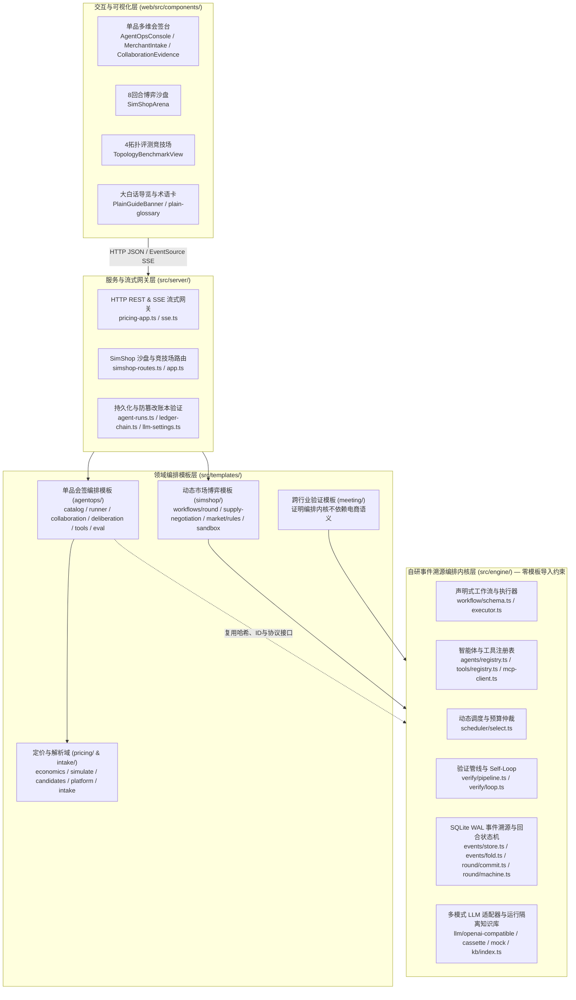
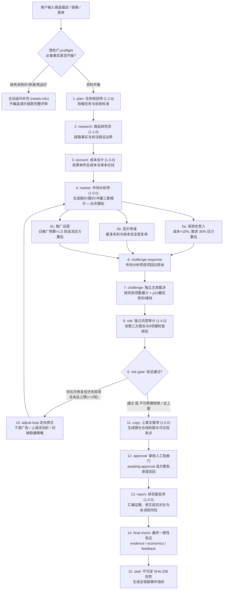
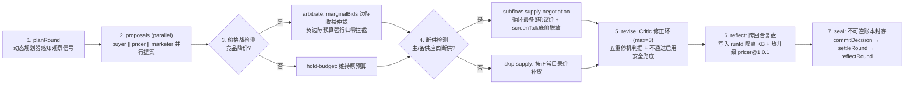

# AgentOps Harness：可信多智能体编排与验证平台项目白皮书（技术方案书）

> **竞赛与赛题**：第五届「未来杯」AI 挑战赛 · 赛题一「Agent 编排创新应用」
> **参赛队伍**：三分拙劲破天下（岭南师范学院）｜**核心成员**：冯茂盛、陈子浩、丁泓江｜**指导教师**：无
> **项目名称**：AgentOps Harness（代码仓库：`agent-ops-lab`）
> **提交命名格式**：`赛题一+三分拙劲破天下+AgentOps Harness-可信多智能体编排与验证平台`
> **核心定位**：面向复杂行业决策场景的**可复用事件溯源多智能体编排、动态调度、对抗验证与防篡改审计平台**
> **演示场景**：电商全链路经营决策闭环（**1. 单品多维会签台** × **2. SimShop 8 回合动态市场与供应链博弈** × **3. 4 拓扑公平对照评测竞技场**）

**评审双口径索引（项目白皮书 5 大板块 ↔ 赛题一方案书 10 章全文映射）**

| 白皮书板块 | 对应核心内容要求 | 本文对应章节 |
| :--- | :--- | :--- |
| **（1）项目概述** | 项目背景、场景需求、应用范围、核心优势 | **第 1 章**（`1.1`~`1.5`，含 `1.4 应用范围`、`1.5 核心优势`） |
| **（2）解决方案** | 架构设计、方案功能、技术内容（编排、调度、验证、代码、AI 边界） | **第 2 章 ~ 第 6 章 & 第 8 章** |
| **（3）应用成效** | 应用情况总述、具体应用案例介绍、自动化测试、消融评测与性能基准 | **第 7 章**（`7.1`~`7.6`，含 `7.1 总述`、`7.2 具体案例`） |
| **（4）商业模式** | 推广模式、市场空间、生态运作与产品分层 | **第 9 章**（`9.1`~`9.3`） |
| **（5）团队介绍** | 核心成员、项目研发覆盖与团队核心优势 | **第 10 章**（`10.1`~`10.3`） |

---

## 目录

1. [项目概述：选题背景、场景需求、应用范围与核心优势](#1-项目概述选题背景场景需求应用范围与核心优势)
2. [平台总体架构设计与技术选型说明](#2-平台总体架构设计与技术选型说明)
3. [Agent 角色定义、工作流设计与编排逻辑详解](#3-agent-角色定义工作流设计与编排逻辑详解)
4. [调度算法与自我循环机制说明](#4-调度算法与自我循环机制说明)
5. [结果验证策略与反馈优化逻辑](#5-结果验证策略与反馈优化逻辑)
6. [核心代码模块说明与系统截图](#6-核心代码模块说明与系统截图)
7. [应用成效、测试用例与性能评估](#7-应用成效测试用例与性能评估)
8. [人工智能使用说明（各环节 LLM、RAG、MCP 等的实际作用、贡献与局限）](#8-人工智能使用说明各环节-llmragmcp-等的实际作用贡献与局限)
9. [商业模式：推广模式、市场空间与生态运作](#9-商业模式推广模式市场空间与生态运作)
10. [团队介绍：核心成员与团队优势](#10-团队介绍核心成员与团队优势)

---

## 1. 项目概述：选题背景、场景需求、应用范围与核心优势

### 1.1 行业背景与大模型多智能体落地的四大工程痛点

近年来，以大语言模型（LLM）为核心驱动力的智能体（Agent）编排技术正在从早期的“单轮问答助手”快速演进为“面向复杂行业任务的多智能体协同系统”。在跨境电商、零售选品、供应链采购、动态定价与资金排期等真实商业决策场景中，单一模型早已无法覆盖长链路任务的多维约束。然而，当前行业内主流的多 Agent 落地形态在走向生产级可信应用时，普遍面临以下四大结构性痛点：

1. **算术幻觉与财务指标失真**：通用语言模型擅长语义理解与文案创作，但在处理平台抽成（佣金率与支付手续费扣减）、逆向退货摊销（往返运费 + 包材折损）、多期账期回款与蒙特卡洛现金流分布时极易产生“心算幻觉”。一旦数字计算交由模型自由生成，建议零售价、保本底价与预期毛利率就可能出现系统性偏差，导致商户按建议上架后“每卖一单亏损一单”。
2. **单 Agent 盲目自信与自由群聊失控**：传统的单 Agent 或无结构群聊式编排（如基于自然语言轮流发言的 GroupChat）存在两个极端弊端。单 Agent 集研究、核算、定价、风控于一身，缺乏利益立场制衡，往往为了迎合用户目标而忽略库存断货、现金穿底或夸大单量等隐性风险；而自由群聊虽然引入了多个角色，但路由不可控、输出不可复现，且风险校验点散落在长篇自然语言对话中，难以通过自动化测试与工程化审计。
3. **仿真回滚作弊与未来信息泄漏（`L1~L8` 漏洞）**：在多回合动态博弈或策略寻优场景中，许多设计看似包含“自我修正循环（Self-Loop）”，实则在结构上暗藏严重的工程作弊与统计偏差。本平台在设计阶段（详见 `docs/design.md`）系统性地识别并从架构层封堵了八类结构性漏洞：

| 漏洞编号 | 传统设计缺陷（反模式） | 导致的系统性失真与审计后果 | 本平台的架构级封堵方案 |
| :--- | :--- | :--- | :--- |
| **L1** | **结果窥视**：固定随机种子时，结算后再回滚重算本回合 | Agent 实质上拿着“已发生的未来需求噪声”反推调参，利润被虚假抬高 | 引入不可逆 `commit` 边界：沙盘推演只能读当前可观察状态，结算后永不重做 |
| **L2** | **重掷骰子偏差**：不固定种子时多次重试并择优保留 | 报告利润实为 $N$ 次随机抽样的极值上界，与基线策略完全不可比 | 固定抽样布局与哈希派生随机流，不同拓扑在相同种子下承受同一组噪声 |
| **L3** | **评测预算不对等**：动态多 Agent 策略比基线多获数倍调用 | “多 Agent 协同更优”的实验结论因算力与调用配额不公平而失效 | 评测竞技场强制对齐统一预算上限（`16,000 tokens`、`24 tool calls`、`60s`） |
| **L4** | **快照当存档读档**：允许任意覆盖修改已写入的历史快照 | 历史经营账本可被事后篡改，合规审计与重放验证失去全部意义 | 快照仅用于崩溃恢复与只读重放；`(runId, round)` 唯一提交槽位拒绝篡改 |
| **L5** | **规则混入生成式销量**：允许 LLM 直接编造或修改市场销量与利润 | 仿真财务数字无法跨机器复现，也无法进行属性测试与数值核查 | 市场结算由纯整数确定性规则计算；LLM 仅负责推理、质询与合规话术生成 |
| **L6** | **纯 LLM Critic 放水**：仅靠大模型口头同意来放行库存或底线约束 | 当模型被提示词诱导时，现金为负、超产能下单、破成本底价等硬约束会被漏放 | 验证管线以代码级硬检查为前置门禁，Critic 的每条异议必须锚定证据 ID |
| **L7** | **随机流与未来事件泄漏**：预测工具共用结算随机流或读取未来日程 | 沙盘预测变成“偷看标准答案”，导致复盘与信念更新机制形同虚设 | 三态类型隔离（`ScenarioTruth` / `Observation` / `PublicModel`）与独立派生流 |
| **L8** | **崩溃重试重复扣款**：结算节点崩溃重跑时重复扣减现金或入库 | 账本资产总额错乱，崩溃恢复后的状态哈希与正常执行路径不一致 | 基于 `(runId, round, decisionHash)` 的幂等键设计与 SQLite WAL 单事务落盘 |

**4. 过程黑盒与责任归属模糊**：现有大多数控制台仅在运行结束时吐出一条终局结论，用户既看不到“哪个 Agent 在何时基于何种评分规则被调度”，也无法验证“模型输出究竟是真实大模型推理，还是出错回退后的本地规则结果”，更无法对关键经营拍板留存具备防篡改能力的电子凭证。

### 1.2 为什么选择「电商全链路经营决策」作为演示与验证载体

“平台级作品”的核心挑战在于：**既不能滑向脱离真实约束的纯文字游戏，也不能做成硬编码串联的业务脚本**。经过综合评估，本平台选择**电商全链路经营决策**作为验证多智能体编排内核的基准行业场景，理由如下：

- **天然的多角色利益冲突与博弈张力**：在真实电商经营中，“采购负责人”关注供应商涨价与资金占用、“定价参谋”坚守目标毛利率与保本红线、“推广运营”追求付费投流杠杆与日单量规模、“独立风控审计”则用悲观情景（`p10` 利润）与合规规则卡死冒险冲动。多角色天然存在目标函数互斥，使得“并行提案 → 交叉质询 → 预算仲裁 → 主席裁决”的编排拓扑具备不可替代的工程价值。
- **同时覆盖“单点深度会签”与“多回合连续博弈”双态**：
  - **单品上架评审（静态闭环 + 30 天现金流蒙特卡洛推演）**：解决卖家“拿不准这款品能不能上、定价多少不亏本、推广费开多少合适、周转金够不够扛过账期”的刚性决策问题。
  - **动态市场与供应链博弈（8 回合连续经营）**：以一家同时经营**茶叶礼盒（`tea`）**与**坚果零食（`snack`）**的网店为沙盘，在 8 个连续回合中面对**主供应商突发断供（`supplycut`）**与**竞品恶性腰斩价格战（`pricewar`）**等危机，全面检验条件分支、嵌套议价子工作流、边际收益仲裁、跨回合策略热升级与防篡改账本。
- **高风险数字资产的严格防篡改诉求**：定价、进货量、广告预算与供应商议价成交价均涉及真金白银的现金流变动，任何一步都要求输入可溯源、过程可回放、落盘不可改。

### 1.3 场景需求分析与三大核心工作台规划

结合真实商户痛点与赛题一的平台级技术要求，本平台构建了彼此独立又业务贯通的三大运行界面与能力矩阵：

| 工作台标签页 | 面向对象与核心场景 | 核心编排与算法需求 | 验收输出与可信证据 |
| :--- | :--- | :--- | :--- |
| **1. 单品多维会签台** | 电商掌柜评估单个新品是否值得上架及如何定价 | • 缺项资料主动预检与追问（禁止编造默认成本）<br>• 10 角色分工流（含三方压力情景质询与市场责任人回应）<br>• 定向经济修正 Self-Loop（下调推广/上调活动折/切换稳健方案）<br>• `awaiting-approval` 掌柜人工拍板门 | • 单件成本拆解与保本红线<br>• 稳价 / 跟价 / 冲量三套方案及 30 天 200 次 `p10/p50/p90` 模拟<br>• SSE 实时事件流与 SHA-256 电子封条<br>• 一键桥接带入 SimShop 沙盘 |
| **2. 8 回合动态市场与供应链博弈（SimShop）** | 验证多智能体在跨周期突发危机下的连续决策韧性 | • 动态规划器按观察信号唤醒子流<br>• 主供断供触发 3 轮 `supply-negotiation` 嵌套议价子工作流与 `screenTalk()` 底价脱敏校验<br>• 竞品价格战触发 `marginalBids` 边际收益仲裁与负边际归零拦截<br>• 跨回合复盘与 `pricer@1.0.0 → 1.0.1` 运行时热升级 | • 8 回合步进回放与逐回合资产/库存/声誉审计<br>• `steady`（稳健）与 `stressed`（高压回退）双画像验证<br>• **HTTP 409 (`round-locked`)** 现场篡改阻断实证 |
| **3. 多 Agent vs 单 Agent 评测竞技场** | 消融对比与量化评估不同编排拓扑的真实收益 | • 同一套冻结基准集与统一度量口径下对比 4 种拓扑：`rule` / `single-agent` / `collab-no-review` / `collab-with-review`<br>• Part A：12 案单品上架难题公平 PK<br>• Part B：8 回合 3 场景（`spring` / `supplycut` / `pricewar`）连续博弈 | • 通过率、漏检率、无依据结论率、正确拒答率、p50/p90 耗时、Token 与工具调用统计<br>• Recharts 累计利润 / 现金 / 声誉多回合趋势曲线与场景胜出归因 |

### 1.4 应用范围与跨行业扩展能力

1. **首发垂直应用范围：多平台电商全链路经营决策**
   - **平台费率与规则覆盖**（`src/templates/pricing/platform.ts`）：完整内置**淘宝/天猫、拼多多、抖音小店、京东、1688、小红书**六大主流电商渠道的参考佣金率、支付手续费率、默认退货率、结算账期与标题字数上限（20–30 字）。
   - **业务环节覆盖**：覆盖新品上架前**无链接缺项预检与成本保本核算**、**促销折扣防击穿审计与限长合规文案生成**、**大促/突发期主供应商断供三轮议价**及**竞品腰斩价格战下的边际收益广告停损**。
   - **使用方式覆盖**：既可作为独立掌柜桌面/Web 决策控制台使用（支持零 API Key 离线确定性核算、CSV 价格表导出及一键带入沙盘），也可通过 `POST /api/agentops/runs` 与 SSE 流式接口嵌入现有 ERP/选品后台。
2. **平台内核的跨行业扩展范围**：基于 `src/engine/**` 对 `src/templates/**` 的零导入物理隔离约束（由 ESLint 与 `test/boundary.test.ts` 强制执行），以及跨行业最小验证模板 `src/templates/meeting/`（`chair → scribe → meeting.both-spoke → seal`）的独立跑通，本编排内核只需替换领域工具与硬约束检查器即可平滑延伸至以下高风险多约束场景：

| 延伸行业场景 | 多角色制衡对应关系 | 核心复用的内核原语与防线 |
| :--- | :--- | :--- |
| **供应链招采与供应商准入审批** | 寻源报价 ∥ 交期核验 ∥ 质量审计 → 风控会签 → 人工定标 | `parallel` + `subflow`（多轮让步议价）+ `screenTalk()` 底价脱敏 + `humanGate` |
| **企业资金排期与营销预算会签** | 业务申预算 ∥ 财务核现金流 → 边际收益仲裁 → 锁账归档 | `allocateBudget()` 负边际归零仲裁 + `Cents` 整数分精度 + `commit` 幂等锁 |
| **金融风控 / 政企合规前置核查** | 事实抽取 → 多维规则硬检 → 证据锚定质询 → 不可逆审计链 | `EvidenceLedger` 零臆造数字正则护栏 + `verify` 4 级管线 + SHA-256 哈希链 |
| **多 Agent 拓扑评测与模型治理基准** | 不同模型/Prompt 版本在统一预算与冻结随机流下公平对照 | `BudgetCeiling` 统一配额 + `latestAgents()` SemVer 热升级 + `Cassette` 确定性回放 |

### 1.5 项目核心优势总览

| 核心优势维度 | 传统单 Agent / 群聊方案常见短板 | AgentOps Harness 工程壁垒与实测表现 |
| :--- | :--- | :--- |
| **内核自主可控与跨界解耦** | 深度绑定第三方图框架，编排逻辑与业务 Prompt 混杂 | **100% 自研事件溯源内核（`src/engine/`）**；静态门禁保障零模板依赖，配套 `meeting/` 验证跨行业复用 |
| **结构化封堵 `L1~L8` 作弊漏洞** | 允许回滚重算、共用随机流、评测预算不对等、浮点精度漂移 | **三态类型隔离 + 整数分 `Cents` + 哈希派生正交随机流 + 统一预算上限**，经 `fast-check` 属性不变量测试验证 |
| **真实制衡协作与可控 Self-Loop** | 单角色盲从或无限口头重试，易虚耗 Token 与延迟 | **10 角色分工 + 三方压力质询 + 五重硬终止判据**（上限/预算/收益停滞/重复哈希），失败切换确定性兜底 |
| **过程透明与密码学级不可篡改** | 无法辨别真实模型推理与回退，历史结论易被覆盖篡改 | **实时 SSE 事件链 + `llm.fallback` 诚实标示 + `EvidenceLedger` 禁数字幻觉 + `HTTP 409 (round-locked)` 锁表** |
| **量化验证领跑与高吞吐低延迟** | 缺乏统一消融对比基线，重并发下状态易串台 | Part A 12 案通过率 **100%（vs 58.3% 基线）**；Part B 总利润 **+¥1,793.00**；SQLite WAL **32,555 events/s** |

---

## 2. 平台总体架构设计与技术选型说明

### 2.1 四层解耦总体架构

AgentOps Harness 严格遵循**“平台编排内核与行业业务模板物理隔离”**的设计哲学。整个工程划分为四层，且通过静态分析自动化测试 `test/boundary.test.ts` 强制保障内核层（`src/engine/**`）绝对禁止导入任何业务模板层（`src/templates/**`）的代码，同时配备了极简的第二验证模板“会议主持与纪要核验最小模板（`src/templates/meeting/`）”，从架构上证明内核的跨行业通用性。



### 2.2 架构方案取舍对比

在项目架构立项期（详见 `docs/design.md` 第 4 节），我们对业界三条主流技术路线进行了深度对比与权衡：

| 评估维度 | 方案 A：基于现成图框架二次包装（如 LangGraph） | **方案 B：自研事件溯源编排内核 + 声明式工作流 + 纯函数市场（本项目采用）** | 方案 C：LLM 主管动态路由群聊（类似 GroupChat） |
| :--- | :--- | :--- | :--- |
| **调度与循环透明度** | 调度规则与检查点语义隐藏在第三方图运行时内部 | **极高**：`resolveAgent()`、`select()`、`revisionStop()` 均为自研白盒逻辑，决策分与候选原因逐条落入事件流 | **差**：路由完全由模型口头指定发言者，易演变为无序聊天 |
| **可复现与不可逆边界** | 检查点偏向对话恢复，难以结构化禁止结算后读档回滚 | **原生支持**：追加写事件日志 + `(runId, round)` 唯一幂等提交槽位 + SHA-256 哈希链，从结构上封杀作弊回滚 | **极差**：多轮自由对话随机性高，同一输入难以稳定重现相同状态链 |
| **工具副作用隔离** | 依赖提示词约束或外挂钩子拦截，容易出现越权调用 | **编译期 + 注册期强校验**：工具显式声明 `read`/`sandbox`/`commit` 副作用，Agent 绑定写工具直接抛 `AgentToolGradeError` | **差**：Function Calling 权限边界往往依赖单层校验 |
| **工程自主可控度** | 核心编排逻辑落在第三方依赖上，难以证明平台级原创度 | **100% 核心自研**：仅使用 Zod、Hono、SQLite、React 等通用基础库 | 缺乏严格图约束与生命周期控制 |

**决定性取舍结论**：采用**方案 B（自研事件溯源编排内核）**，同时吸收方案 C 中“由模型提出初始候选”的灵活性——在调度器 `select()` 中允许外部规划器（`planner`）提议候选 Agent 与子流列表，但最终是否激活、占用多少预算、发生资金冲突时如何分配现金，全部交由内核的规则评分器、依赖就绪队列与边际收益仲裁器裁决。这既保留了智能体的语义弹性，又牢牢守住了工程系统的确定性与可审计底线。

### 2.3 三态信息隔离机制与数据精度保障

为彻底杜绝上文所述的 `L1`、`L4`、`L5`、`L7` 等信息泄漏与计算误差问题，平台在数据建模与类型系统层面实施了三项硬性隔离措施：

1. **三态类型隔离（`ScenarioTruth` vs `Observation` vs `PublicModel`）**：
   - `ScenarioTruth`（真实市场参数表、未来回合竞品降价/断供日程、真实价格弹性）：**仅市场结算纯函数 `settle()` 可访问**，任何 Agent、工具、知识库及沙盘函数均无法引用该类型，且已通过 `test/observation.test.ts` 进行不变量属性测试——扰动未来回合事件或隐藏参数，`Observation` 与沙盘输出字节级完全不变。
   - `Observation = project(State, Truth, roundIndex)`：通过投影函数生成每回合 Agent 可见的合法观测快照（当前现金、可用库存、声誉、当期公开竞品价与当期新闻）。
   - `PublicModel`：沙盘工具专用的公开市场参数估计（初始为名义值，随每回合真实成交复盘缓慢修正），保证预测存在合理误差、跨回合复盘才有学习价值。
2. **全链路整数「分」（`Cents` Branded Type）与规范化 JSON**：所有货币金额、价格、采购成本、广告支出及利润一律采用整型“分”（`cents`）存储与运算，在入口处通过品牌类型守卫（`src/templates/simshop/market/brand.ts`）拒绝浮点数与非法小数；所有哈希计算前均经过 `canonicalJson()` 键名字典序规范化序列化，确保跨平台计算 SHA-256 指纹完全一致。
3. **哈希派生互不重叠随机流**：所有随机过程放弃脆弱的“种子 + 偏移量”做法，采用 `sha256(seed, stream, round, sku, k)` 派生互相正交的三条随机流：
   - `settle` 结算流（仅真实结算读取）
   - `forecast` 预测流（仅沙盘推演读取）
   - `events` 事件流（控制随机事件与危机卡生效细节）

### 2.4 技术选型清单

| 技术层次 | 选用技术与版本约束 | 选型理由与平台工程作用 |
| :--- | :--- | :--- |
| **运行时与包管理** | Node.js ≥ 22、`pnpm` 10、TypeScript 5（ESM） | 利用原生 `node:sqlite` 与严格 ESM 类型系统实现零额外原生编译依赖，前后端共享领域类型模型（`src/templates/agentops/types.ts`） |
| **服务与流式网关** | Hono 4 (`@hono/node-server`) | 轻量级长生命周期 HTTP 服务与原生 `text/event-stream`（SSE）流式推送框架，支持每帧附带 `emittedAt` 戳记以测量毫秒级端到端渲染延迟 |
| **事件存储与持久化** | SQLite（`WAL` 模式 + `synchronous=NORMAL`）+ 文件卷宗 | 单表事件追加写保障原子落盘与崩溃恢复；非空 `idempotencyKey` 唯一索引结构化实现提交与结算幂等 |
| **契约校验与工具描述** | Zod 4（`z.strictObject` + `toJSONSchema`） | 同时承担 API 请求严校验（拒收未知字段）、Agent 输出 Schema 解析与 Function Calling JSON Schema 自动生成 |
| **前端控制台与可视化** | React 19 + Vite + Tailwind CSS + Recharts + Lucide | 延续“纸白（`#fdfbf5`）、墨色（`#201c16`）、印章红（`#c4442b`）、玉绿（`#2e6b52`）、赭色（`#b07a2e`）”账本审计美学，支持 `320px` 超窄屏横向零溢出 |
| **质量保障与评测工具** | Vitest 3 + `fast-check` 4 + Playwright | 支持单元测试、属性不变量测试（Property-based Testing）、录制回放（Cassette）以及真实 Chromium 浏览器全链路并发竞态测试 |

---

## 3. Agent 角色定义、工作流设计与编排逻辑详解

### 3.1 Agent 角色定义体系与能力画像（`AgentSpec`）

本平台中所有智能体均通过结构化声明契约 `AgentSpec` 注册管理（平台内核见 `src/engine/agents/registry.ts`，会签产品层见 `src/templates/agentops/catalog.ts`）。每个 Agent 显式携带**唯一 ID、语义化版本号（SemVer）、职责描述、能力向量（0~1 区间）、白名单工具集、记忆模式及每轮/每次调用预算上限**。

#### 3.1.1 单品多维会签台：10 大专业 Agent 团队与单 Agent 基线

为覆盖商品上架评审的全维度约束，会签台定义了 10 个高度专业化的协作角色（并保留早期 7 角色版本 `AGENTS_V1` 作为兼容目录），同时单独注册 `generalist` 作为公平消融实验中的“单 Agent 基线”：

| Agent ID | 中文角色名 | 版本 | 能力向量（`capabilities`） | 绑定白名单工具集（`tools`） | 调用上限 | 核心职责与制衡立场 |
| :--- | :--- | :--- | :--- | :--- | :---: | :--- |
| `planner` | 任务规划师 | `1.2.0` | `planning: 0.98` | `workflow.plan` | 2 | 将用户自然语言意图拆解为带依赖关系的 DAG 工作流，识别缺失字段、硬约束与验收标准 |
| `link-researcher` | 商品研究员 | `1.1.0` | `intake: 0.95`, `market: 0.62` | `product.parse`, `knowledge.search` | 4 | 解析商品链接与分享文案，提取名称/类目/价格/服务，区分“用户明确提供”与“演示假设”，禁止伪造短链抓取事实 |
| `cost-accountant` | 成本会计 | `1.3.0` | `cost: 0.99`, `risk: 0.55` | `pricing.unit-cost`, `pricing.break-even`, `knowledge.search` | 3 | 仅使用采购、包材、快递、平台佣金、支付手续费与退货损耗计算单件总成本与保本红线，不越权出报价 |
| `market-analyst` | 市场分析师 | `1.0.0` | `market: 0.92`, `planning: 0.45` | `pricing.candidates`, `pricing.simulate`, `pricing.verify`, `knowledge.search` | 3 | 消费保本价与市场锚点产出“稳价/跟价/冲量”三套定价策略及 30 天蒙特卡洛推演，并在会签中逐项回应专家质询 |
| `procurement-lead` | 采购负责人 | `1.0.0` | `procure: 0.98`, `cost: 0.50`, `risk: 0.40` | `pricing.simulate`, `pricing.unit-cost`, `knowledge.search` | 3 | 施加**压力假设（采购成本 +10%、市场需求 -30%）**重估三套报价，严防涨价与积压断流 |
| `pricing-lead` | 定价参谋 | `1.0.0` | `price: 0.98`, `market: 0.40`, `cost: 0.40` | `pricing.candidates`, `pricing.verify`, `knowledge.search` | 3 | 基准情景下坚守目标毛利率与保本安全垫，质询低毛利“跟价/冲量”方案的佣金侵蚀风险 |
| `growth-operator` | 推广运营 | `1.0.0` | `promote: 0.98`, `market: 0.40`, `risk: 0.30` | `pricing.simulate`, `copy.generate`, `knowledge.search` | 3 | 施加**压力假设（日推广预算 ×1.5）**测算放量单量，对高投流占比或资金穿底发出警示 |
| `risk-auditor` | 独立风控审计 | `1.4.0` | `risk: 0.99`, `cost: 0.62` | `pricing.verify`, `pricing.simulate`, `knowledge.search` | 8 | 消费三方报告与 8 项领域校验，主持裁决推荐方案切换或驳回，并在不通过时向市场节点发起定向经济修正 |
| `copywriter` | 上架文案师 | `1.0.0` | `copy: 0.96` | `copy.generate` | 2 | 根据终审方案与平台字数限制撰写可兑现标题卖点，禁用“全网最低/销量第一”等极限词 |
| `reporter` | 研究报告师 | `1.0.0` | `report: 0.94` | `report.compile` | 2 | 汇编会签过程、证据边界、修正历史与未消除风险，输出可逐事件回放的审计报告 |
| `generalist` *(对照组)* | 综合执行 Agent | `1.0.0` | 全 10 项能力均为 `1.0` | 全部 10 个工具 | 32 | 仅在 `singleAgent: true` 基线评测时启用，单体串联全流程、无多方质询与独立交叉核验 |

#### 3.1.2 SimShop 8 回合动态市场博弈：5 大经营角色与供应商规则体

在内核驱动的 SimShop 8 回合博弈场景中（`src/templates/simshop/agents.ts`），系统注册了 5 个核心角色及独立规则演进体：

- **`buyer`（采购 Agent）**：对应技能 `procure: 0.8`，绑定沙盘工具 `shop.forecast`，负责在可见产能与现金边界内制定茶叶（`tea`）与零食（`snack`）的补货量及主/备供应商分配。
- **`pricer`（定价 Agent）**：对应技能 `price: 0.8`，初始版本 `1.0.0`，第 1 回合复盘后运行时动态注册升级为 `1.0.1`（携带更新后的 `PromptHash`），负责两款 SKU 的整分定价与价格战跟价响应。
- **`marketer`（投放 Agent）**：对应技能 `promote: 0.8`，负责申报每回合营销投放预算（`adSpend`），参与价格战期间的现金边际收益竞价。
- **`critic`（风控 Critic）**：对应技能 `review: 0.8`，无写工具权限，消费校验器输出与沙盘预测区间，产生带精确证据引用的反对意见或置信度。
- **`reflect`（复盘 Reflect）**：对应技能 `reflect: 0.8`，记忆模式为 `kb`（写入按 `runId` 隔离的知识库覆盖层），在每回合不可逆结算后对比预期与实际成果，提炼策略补丁并驱动版本热升级。
- **主/备供应商规则议价体（`primary` / `backup`）**：价格与让步曲线由确定性规则函数 `acceptOrCounter()` 控制（含隐藏采购底价与交期），谈判语言可由模型/Mock 生成并经过 `screenTalk()` 底价数字脱敏校验，防止底价泄露。

### 3.2 9 种声明式工作流节点原语与静态校验规则

内核层通过 `src/engine/workflow/schema.ts` 定义了一套强类型、可序列化、可做静态可达性与无环检测的声明式工作流原语，所有工作流在执行前必须通过 `parseWorkflowDocument()` 校验：

| 节点原语 (`kind`) | 关键配置字段 | 语义与安全防线设计 |
| :--- | :--- | :--- |
| `agent` | `id`, `agent`/`capability`, `task`, `dependsOn` | 经调度器匹配候选并记录 `NodeScheduled`/`dispatch.decided`；支持超时自动重试与 `NodeDeadLetter` 死信降级 |
| `tool` | `id`, `tool`, `dependsOn` | 调用受 Zod 输入输出契约约束的注册工具；执行耗时与结果自动进事件流 |
| `parallel` | `id`, `branches`, `join` (`all`/`any`/`quorum`), `dependsOn` | 并行调度所有独立分支并按汇聚策略等待完成；静态校验禁止子分支再声明外部依赖，确保控制流所有权唯一 |
| `condition` | `id`, `predicate`, `then`, `else`, `dependsOn` | 调用已注册谓词 ID 进行确定性分支路由，禁止在 JSON 工作流定义中嵌入任意可执行脚本代码 |
| `loop` | `id`, `body`, `until`, `maxIterations`, `dependsOn` | **强制 `maxIterations` 为正整数**，结构上杜绝无限循环；每轮循环强制写回迭代快照 |
| `subflow` | `id`, `workflow`, `dependsOn` | 嵌套调用另一已注册子工作流（如断供三轮议价）；静态分析 `walkSubflows()` 检测并阻断循环嵌套引用 |
| `verify` | `id`, `pipeline`, `dependsOn` | 运行多阶段验证管线（证据边界、经济学计算、约束合规、报告完整性） |
| `humanGate` | `id`, `timeoutMs`, `onTimeout` (`approve`/`fallback`) | 暂停运行进入 `awaiting-approval` 人工拍板门，未拍板前锁定后续报告与封存动作 |
| `commit` | `id`, `dependsOn` | 内核或工作流终局不可逆提交边界，计算指纹并锁定历史态，禁止二次覆盖 |

### 3.3 双核心工作流拓扑与编排逻辑详解

#### 3.3.1 工作流一：单品多方会签质询工作流（`COLLAB_WORKFLOW` / `product-launch-review.v2`）

该工作流（定义于 `src/templates/agentops/catalog.ts`）由 **17 个声明式节点**构成，完整实现了“资料预检门 → 分工核算与独立报价 → 三方压力并行复核 → 责任人逐项回应 → 独立主席裁决 → 定向经济修正循环 → 掌柜人工拍板门 → 终检与哈希封存”的闭环编排。相比早期将成本与市场并行的 `DEFAULT_WORKFLOW`（v1），v2 显式建立了“市场分析师消费成本会计产出的保本价”的真实数据依赖，并引入了三方对抗质询子链路。



#### 3.3.2 工作流二：SimShop 8 回合动态经营与嵌套议价工作流（`round.ts`）

SimShop 每回合在内核 `runWorkflow()` 调度器上执行标准化的 7 步核心管线（包含条件分支与最多 3 轮嵌套循环子工作流），并严格遵循从“可反复沙盘阶段”跨越“不可逆提交边界”进入“幂等结算与跨回合复盘”的 12 阶段回合状态机（`src/engine/round/machine.ts`）：



---

## 4. 调度算法与自我循环机制说明

平台围绕“透明可解释的智能调度”与“可控收敛的自我循环”构建了三套核心算法，所有调度决策、候选打分与循环快照均作为一等事件记录在审计日志中。

### 4.1 多维动态调度与预算仲裁算法

#### 4.1.1 会签台动态调度评分函数 `resolveAgent()`

在单品多维会签台工作流（`src/templates/agentops/catalog.ts` 第 162–183 行）中，工作流节点仅声明所需能力标签（`need: Capability`），不硬编码具体 Agent 实例。运行时调度器 `resolveAgent()` 执行两阶段筛选与打分：

1. **资格与预算过滤**：从当前可用 Agent 池中过滤出具备所需能力（$\text{Cap}(a, c) > 0$）且当次运行剩余调用预算充足（$\text{Calls}(a) < a.\text{maxCallsPerRun}$）的候选集合；同时实施**专职预算隔离策略**（`runner.ts` 第 197 行）——非 `procure`/`price`/`promote` 通用节点禁止占用三位专家的受限调用次数，防止通用风控或核算回退耗尽专家配额。
2. **多维效用打分与确定性平局决胜**：对每个合格候选 Agent 计算综合调度分：

$$\text{Score}(a, c) = \operatorname{round}\Big( 100 \times \text{Cap}(a, c) - 9 \times \text{Load}(a) - 15 \times \text{Fail}(a),\; 2 \Big)$$

其中：
- $\text{Cap}(a, c) \in [0, 1]$ 为 Agent $a$ 在能力 $c$ 上的注册能力画像分；
- $\text{Load}(a)$ 为当前运行中已累计指派给 $a$ 的次数（采用累计分配次数惩罚而非瞬时并发数，既能防止单一全能角色垄断负载，又保证了整条流水线各节点调度分的可回放稳定性）；
- $\text{Fail}(a)$ 为 $a$ 在当前运行中的历史失败次数（高惩罚系数 `-15` 促使调度器在主角色异常时迅速降权切换至备选能力者）；
- 若出现总分完全相同的情况，严格按照 `agent.id` 字典序升序决胜，确保跨机器 100% 确定性。

每次调度均向 `dispatch.decided` 事件写入完整候选排行榜与文字理由，例如：`需求=risk；从 3 个候选中按能力、当前负载、历史失败次数选择 独立风控审计`。

#### 4.1.2 内核信号驱动调度 `select()` 与 SemVer 运行时热升级发现

在通用编排内核层（`src/engine/scheduler/select.ts`），调度器 `select()` 在每回合开始前执行三大职责：

1. **动态信号路由与能力准入**：规划器读取当前回合观察信号（如 `calm`、`supply-cut`），动态提议需激活的 Agent 集合与按需子工作流（如断供时才激活 `supply-negotiation`）。内核遍历注册表，逐一校验 `ready`（前置依赖就绪状态）、`requiredSkill >= minScore` 能力阈值以及 `callBudget` 全局调用总预算，所有被采纳或被拒绝的决策均附带标准理由写入 `NodeScheduled` 事件。
2. **最高 SemVer 版本自动发现（热升级底座）**：在构建候选列表前，`latestAgents()` 通过 `compareSemVer()` 按主/次/修订号三段解析比对同一 `agentId` 下的所有注册版本，**自动选取最高语义化版本**作为本回合候选。当第 1 回合复盘节点通过 `registerPromptVersion()` 动态注入 `pricer@1.0.1` 后，第 2 回合起无需重启进程或更改工作流定义，调度器即自动切换至新版本，并在事件中精确记录新的 `agent: "pricer@1.0.1"` 与新的 `promptHash`。

#### 4.1.3 价格战边际收益现金预算仲裁 `allocateBudget()`

当多方方案同时争夺有限流动现金（如价格战期间：投放运营申请加码防卫广告 `ads`，定价参谋申请跟进降价让利 `priceCut`）时，平台禁止采用主观投票或平均分配，而是执行**基于沙盘边际收益的确定性现金仲裁**（`src/engine/scheduler/select.ts` 第 402–435 行及 `src/templates/simshop/sandbox.ts`）：

1. 仲裁前置：沙盘工具 `marginalBids()` 分别在独立预测流中模拟“增加广告投入”和“降价跟进”两个候选动作相对于基准方案的边际净利润增量 $\Delta \text{Profit}_i$。
2. 负边际截断与归零拦截：对于任意申请项 $i$，构造非负有效权重 $w_i = \max(0, \text{bid}_i)$。当恶性价格战中竞品把价格腰斩至成本线附近甚至以下时，沙盘计算出跟降与投流的边际收益均为负数（$\text{bid}_{\text{ads}} \le 0, \text{bid}_{\text{priceCut}} \le 0$），有效权重总和 $S = \sum w_i = 0$，仲裁器强制返回 **0 元分配（负边际归零拦截）**，避免无底洞失血。
3. 整数按比例分配与余数收敛：当 $S > 0$ 时，按 $a_i = \lfloor B \times w_i / S \rfloor$ 分配整数“分”预算，并将整除余数 $B - \sum a_i$ 归并至首个正权重获胜者，保证分配总额严格等于可用预算且绝不超支现金。

### 4.2 双层自我循环（Self-Loop）机制详解

本平台区分了**单次运行/单回合内部的“定向修正循环”**与**跨回合演进的“复盘热升级循环”**，形成结构完备、边界清晰的双闭环机制：

#### 4.2.1 机制一：单品会签台的定向经济修正环（Bounded Targeted Self-Loop）

在单品会签台执行至 `risk`（独立风控审计）未通过时，系统通过 `planEconomicAdjustment()`（`src/templates/agentops/runner.ts` 第 745–805 行）严格区分“**可修复的经济参数失衡**”与“**不可靠空转修复的硬事实缺陷**”：

- **三类精确定向修正动作**（最多执行 2 轮修正，加上初始轮共 3 轮验证）：
  1. `ad-budget`：当 `ad-share` 检查失败且推广分摊占售价 $> 20\%$、日预算 $> 100$ 分时，按比例下调日推广预算（每次缩减为原预算的 $60\%$，保底 `100` 分）后重跑市场模拟与风控审计。
  2. `promo-discount`：当 `promo` 检查失败（开启活动后折后价低于保本价）时，依据公式 $\text{discount} = \operatorname{clamp}\big(\lceil (\text{breakEven} / \text{price}) \times 100 \rceil / 100 + 0.01,\; 0.4,\; 0.99\big)$ 自动上调活动折扣率，使折后活动价刚好安全站上保本线。
  3. `switch-candidate`：当 `cashflow`、`margin` 或 `break-even` 未达标时，从三套候选中寻找售价更稳健或失血更少的替代策略（如从“冲量”切换为“跟价”或“稳价”）。
- **防空转机制**：若失败原因属于**成本倒挂**（如进货+快递裸成本已远高于竞品售价）或**缺失必补事实**，修正规划器直接返回 `null` 停止空转，诚实将硬拒绝原因或待确认问题暴露给掌柜，并在界面记录每轮修正前后的完整快照对比（售价、毛利率、`p10` 利润、推广预算、活动折扣、失败项变化）。

#### 4.2.2 机制二：内核验证循环 `revisionLoop()` 的五重硬终止判据与兜底

在通用引擎内核层（`src/engine/verify/loop.ts`），`revisionStop()` 对每一次修正迭代强制校验五重终止条件，只要命中任意一项立即终止循环，彻底消除大模型 Agent 常见的高延迟与死循环风险：

| 终止条件 (`StopReason`) | 数学判据 | 工程意义与防线作用 |
| :--- | :--- | :--- |
| `passed` | `report.verdict === "pass"` | 方案同时通过 Schema、全部代码级硬检查且有效 Critic 异议清零，立即放行 |
| `maxIterations` | `iteration >= maxIterations`（默认 `3`） | 强硬限制单回合最大重试次数，确保延迟与成本有绝对上界 |
| `budget` | `callsUsed >= callBudget` | 运行期调用配额耗尽即熔断，防止单个复杂节点拖垮整局预算 |
| `p50Plateau` | `p50 - previousP50 < p50Threshold` | 沙盘中位利润改善幅度进入平台期，说明继续纠缠调参收益微弱，及时止损 |
| `repeatedDecision` | `seenHashes.includes(decisionHash)` | 检测到 Agent 提出了与前序某轮规范化哈希完全相同的重复方案，阻断“A→B→A”振荡死循环 |

当循环因非 `passed` 原因退出时（例如在 SimShop `stressed` 高压测试画像中故意连续 3 轮注入超现金广告预算），系统绝不允许带病提案进入结算，而是自动切换为确定性规则兜底 `fallbackDecision()`（`src/templates/simshop/fallback.ts`）：维持上回合价格、将广告支出强行归零、在可见剩余产能与当前可用现金的严格交集内仅按名义基础需求缺口保守补货，保证全部硬约束 100% 满足。

#### 4.2.3 机制三：跨回合复盘与版本热升级循环（Cross-Round Reflection Loop）

在每回合完成 `settleRound()` 真实结算后，`reflect` 节点对比“沙盘预测值”与“真实结算结果”，生成结构化反思笔记（`RoundMemory` 按 `runId` 严格隔离，不污染其他种子或策略运行的知识底库）与策略补丁 `patch`，在 `sealRound()` 阶段调用 `registerPricerPatch()` 运行时注册 `pricer@1.0.1`。从下一回合起，调度器自动选择升级后的 Agent 版本继续博弈，完成**“决策 → 不可逆结算 → 复盘经验入库 → 运行时版本热升级 → 下一回合智能调度”**的跨周期进化闭环。

---

## 5. 结果验证策略与反馈优化逻辑

本平台摒弃“靠大模型自评是否合理”的弱验证方式，建立了一套涵盖**量化经济学模型、四级递进验证管线、闭环对抗质询、证据防幻觉账本以及不可逆哈希封存**的全链路验证体系。

### 5.1 领域经济学量化底座与 30 天蒙特卡洛沙盘

所有数值测算全部由位于 `src/templates/pricing/` 的纯确定性函数完成（输入相同时跨节点计算逐字节一致）：

$$\text{退货摊销} = \text{退货率} \times \big( 2 \times \text{单程快递费} + \text{包材费} + \text{采购价} \times (1 - \text{残值率}) \big)$$

$$\text{一件总成本}(P) = \text{采购价} + \text{包材} + \text{快递} + \operatorname{round}(P \times \text{佣金率}) + \operatorname{round}(P \times \text{支付费率}) + \text{退货摊销}$$

$$\text{保本底价} = \left\lceil \frac{\text{采购价} + \text{包材} + \text{快递} + \text{退货摊销}}{1 - \text{佣金率} - \text{支付费率}} \right\rceil$$

$$\text{预测日需求}(P) = \min\Big(\text{市场日单量} \times \left(\frac{\text{竞品价}}{P}\right)^{\text{弹性}},\; 8 \times \text{市场日单量}\Big) + \frac{\text{日推广预算}}{\text{点击单价}} \times \text{转化率}$$

- **30 天 × 200 次蒙特卡洛现金流推演**（`simulate.ts`）：基于确定性伪随机数生成器 `mulberry32`，每日对自然需求施加标准差 $\sigma = 0.28$ 的对数正态随机波动，同时耦合“受当前可用周转金限制的备货上限 $\lfloor \text{现金} / (\text{采购}+\text{包材}) \rfloor$”与“按平台账期 `settleDays` 延后回款”的资金约束，连续推演 30 天并运行 200 次样本，统计累计利润分布的 **`p10`（最悲观 10% 分位兜底值）、`p50`（中位预期）与 `p90`（乐观分位）**。平台推荐策略默认按**“在满足安全校验前提下取 `p10` 最高”**原则选出，宁可少赚也不赌运气。

### 5.2 四级递进验证管线（Schema → 硬约束 → 沙盘 → 对抗质询）

内核 `verifyDecision()`（`src/engine/verify/pipeline.ts`）与产品层 `checksFor()`（`src/templates/pricing/candidates.ts`）共同构成四级防穿透安检门：

1. **第一级：Zod 严格结构校验（Schema Gate）**：拦截非 JSON、缺少必填字段、类型错误（如价格非整数分）或包含未定义额外字段的提案，失败直接返回 `verdict: "reject"`。
2. **第二级：代码级领域硬约束校验（Hard Checks）**：
   - **SimShop 4 项硬约束**：`cash-after`（决策执行后现金不得为负）、`order-qty`（总订货量不得超过供应商当期可见产能）、`price-floor`（整数售价不得低于所选供应商单位进货成本）、`ad-spend`（广告支出必须在 `[0, cash]` 范围内）。
   - **单品会签台 7+1 项核心审计**：① `break-even`（售价高出保本价 5% 以上为 pass，0~5% 为 warn，低于保本为 fail）；② `margin`（毛利率达标判断）；③ `ad-share`（推广分摊占售价比例：$\le 12\%$ pass，$12\%\sim 20\%$ warn，$>20\%$ fail）；④ `returns`（退货率相对平台参考基线的偏离度）；⑤ `competitor`（报价与竞品价带偏离度 $\pm 25\%$ / $\pm 40\%$）；⑥ `cashflow`（30 天模拟缺货天数：$0$ 天 pass，$1\sim 5$ 天 warn，$>5$ 天 fail）；⑦ `promo`（开启促销折扣后的活动价不得击穿保本底价）；以及 **市场需求合理性交叉校验**（如小众品类宣称超周转能力 1500+ 日单量时自动追加 `market-demand-doubt` 风险警示）。
   - **谈判话术防泄漏校验 `screenTalk()`**：扫描供应商或代理商生成的所有文字输出，一旦包含采购底价的数字字符序列，立即判为未通过并剥离文本，阻断价格底牌泄露。
3. **第三级：独立沙盘量化预测（Sandbox Forecast）**：对通过硬约束的候选决策在隔离预测流中跑出 `p10/p50/p90` 与缺货风险指标，作为下一级 Critic 的客观量化凭据。
4. **第四级：证据锚定的 Critic 质询与空泛异议剔除**：Critic 提出的每条反对意见 `{ claim, evidence }` 必须准确引用某个失败的硬检查项 ID 或 `"forecast"` 沙盘输出；**任何既未指出失败检查项又未引用沙盘数字的无根据异议会被内核自动丢弃（写入 `dropped` 数组）**，防止风控角色无端“发脾气”干扰正常决策。

### 5.3 四阶段闭环对抗会审与 `EvidenceLedger` 反幻觉协议

在开启多专家协作会审时（`src/templates/agentops/collaboration.ts` 与 `deliberation.ts`），系统运行如下严密的反馈与优化逻辑：

- **三方独立压力分析与跨角色响应**：采购负责人（成本 +10% / 需求 -30%）、定价参谋（基准毛利线）、推广运营（预算 ×1.5）各自调用只读工具算出三套方案在压力情景下的表现并提出质询；`respondToObjections()` 强制市场分析师对每条质询给出书面回应，但**系统明确约定“回应仅代表已接收，绝不自动消除风险”**，仍留存 `leftoverRisks` 供终审与掌柜查看。
- **独立主席裁决逻辑 `adjudicateCollaboration()`**：按照**“优先对比各策略在三方会审中收获的 `fail` 质询总数最少 → 其次比较基准 `p10` 悲观利润最高 → 再比较原推荐优先级”**的客观排序法则裁决最终推荐策略（例如在测试集 `conflict-demand-cap` 与真实案例保温杯任务中，将原推荐的“跟价”科学改判为“稳价”，即发生 **Decision Flip**）。若所有候选均无法摆脱核心失败项，系统在裁决摘要中诚实声明“仍有失败项，不能视为会签通过”，或直接触发系统硬驳回（`reject`）。
- **事实溯源账本与“零臆造数字”强正则审计**：`createEvidenceLedger()` 为所有输入事实与计算行签发唯一 `EvidenceEntry`（携带 `merchant_explicit` / `link_extracted` / `rule_assumption` 溯源标签）；大模型在四阶段闭环（Proposal → Challenge → Revision → Verdict）输出的全部中文评述均受 `assertNoInventedNumbers()` 校验——剥离合法统计代号 `p10`/`p50`/`p90` 后，**正文严禁包含任何阿拉伯数字、全角数字、货币符或百分号**，必须通过 `evidenceRefs` 字段引用工具账本中的真实 ID，一旦违规或引用不存在的 ID 立即打回携带错误提示单次重试，再失败则降级。

### 5.4 人工拍板门与 SHA-256 哈希链防篡改封存

1. **掌柜拍板门禁（Human Gate）**：会签台在控制台默认以 `autoApprove: false` 模式启动。流程运行到 `approval` 节点时状态变为 `awaiting-approval`，前端仅允许掌柜在详尽审阅成本、三方压力情景与遗留风险后点击“通过（选择某套策略）”或“驳回”。只有收到真实人工指令后，流程才继续推进 `report → final-check → seal`。若已封存后再次提交冲突的决策，后端 `DecisionConflictError` 返回 HTTP 409 拒绝对话篡改。
2. **双层 SHA-256 哈希链与可验证封条**：
   - **会签台事件链（`verifyRunIntegrity`）**：每条 `RunEvent` 均计算 $\text{hash}_k = \text{SHA256}(\text{canonicalJson}(\{\text{version}: 1, \text{prevHash}_{k-1}, \text{seq}_k, \text{type}_k, \text{detail}_k\}))$，初始 `prevHash` 为 64 个 `'0'`；运行封存时对 `{ workflow, events, artifacts }` 计算全量电子指纹。任何单条事件文案或序列被改动都会导致链校验失败并精确锁定 `firstBrokenSeq`。
   - **SimShop 回合链与 HTTP 409 铁证（`commitDecision` & `ledgerDigest`）**：每个 `(runId, round)` 使用唯一幂等键 `${runId}|${round}|commit` 写入 `DecisionCommitted` 事件。前端在 SimShop 页面内置了**“尝试重做/篡改”**交互按钮——点击后真实向后端发起修改已结算回合参数的请求，内核检测到幂等槽位已占用且 `decisionHash != storedDecisionHash`，直接抛出 `RoundAlreadyCommitted` 错误并返回 **HTTP 409 (`round-locked`)**，在界面同时亮出旧决策哈希、尝试提交的新哈希与已锁定回合哈希，用硬核密码学协议而非前端禁用按钮来证明不可逆防篡改。

---

## 6. 核心代码模块说明与系统截图

### 6.1 全仓库核心代码模块与职责分布

| 模块路径 | 核心文件清单 | 职责说明与工程边界 |
| :--- | :--- | :--- |
| **自研编排内核** (`src/engine/`) | `workflow/schema.ts`, `workflow/executor.ts`, `scheduler/select.ts`, `verify/pipeline.ts`, `verify/loop.ts`, `events/store.ts`, `round/commit.ts`, `round/machine.ts`, `agents/registry.ts`, `tools/registry.ts`, `tools/mcp-client.ts`, `kb/index.ts`, `llm/*` | 与具体业务完全隔离的可复用多 Agent 内核：声明式工作流图、信号调度与现金分配、4 级验证与 5 重终止环、SQLite WAL 追加写存储、幂等提交状态机、Stdio JSON-RPC MCP 客户端、按运行隔离的知识库与多模式 LLM 适配器 |
| **会签产品编排** (`src/templates/agentops/`) | `catalog.ts`, `runner.ts`, `orchestrator.ts`, `preflight.ts`, `compose.ts`, `task-facts.ts`, `tools.ts`, `collaboration.ts`, `deliberation.ts`, `decision-act.ts`, `evidence-ledger.ts`, `review-policy.ts`, `protocol-retrieval.ts`, `llm.ts`, `integrity.ts`, `stored-run.ts` | 10 角色团队与 17 节点 DAG 定义、SSE 运行时编排与定向经济修正环、缺项追问预检、9 个白名单只读工具、3 方压力会签与 4 阶段模型闭环会审、`EvidenceLedger` 防幻觉协议、完整性验签 |
| **基准评测套件** (`src/templates/agentops/eval/`) | `dataset.ts`, `harness.ts`, `live-flag.ts`, `types.ts` | SHA-256 哈希冻结的 12 案单品评测数据集、4 拓扑公平对照评测驱动（同时涵盖 Part A 12 案与 Part B SimShop 8 回合 3 场景对比）、`--live` 真模型验证开关 |
| **SimShop 博弈沙盘** (`src/templates/simshop/`) | `workflows/round.ts`, `workflows/supply-negotiation.ts`, `agents.ts`, `constraints.ts`, `sandbox.ts`, `supplier.ts`, `fallback.ts`, `memory.ts`, `mcp-server.ts`, `market/*` | 8 回合双 SKU 经营流、3 轮断供议价子工作流、底价脱敏校验 `screenTalk()`、`marginalBids` 边际收益计算、4 项经营硬检查、`ScenarioTruth` 隔离投影与纯函数结算规则 |
| **领域计算与解析** (`src/templates/pricing/`, `intake/`) | `economics.ts`, `simulate.ts`, `candidates.ts`, `copy.ts`, `platform.ts`, `agent.ts`, `link.ts`, `text.ts` | 单件成本/退货摊销/保本价/价格弹性算式、30 天 × 200 次现金流蒙特卡洛模拟、6 大平台（淘宝/拼多多/京东/抖音/小红书/1688）默认费率、无外网规则式链接文案提取 |
| **网关与控制台** (`src/server/`, `web/src/`) | `pricing-app.ts`, `simshop-routes.ts`, `sse.ts`, `agent-runs.ts`, `ledger-chain.ts`, `AgentOpsConsole.tsx`, `SimShopArena.tsx`, `TopologyBenchmarkView.tsx`, `CollaborationEvidence.tsx`, `MerchantIntake.tsx`, `PlainGuideBanner.tsx` | Hono REST/SSE 服务端、卷宗持久化与篡改检测接口、React 纸质台账视觉控制台与响应式布局 |

### 6.2 关键核心代码模块深度剖析

#### （1）多维动态调度评分：`resolveAgent()`（`src/templates/agentops/catalog.ts`）

该函数基于能力匹配度、当前运行累计负载与历史失败惩罚，动态择优指派 Agent，并保留完整的候选排名列表写入审计事件：

```ts
export function resolveAgent(
  need: Capability,
  loads: Readonly<Record<string, number>>,
  failures: Readonly<Record<string, number>>,
  calls: Readonly<Record<string, number>>,
  agents: readonly AgentSpec[] = AGENTS,
): { readonly agent: AgentSpec; readonly scores: readonly { readonly agent: AgentSpec; readonly score: number }[] } {
  const eligible = agents.filter(
    (agent) => (agent.capabilities[need] ?? 0) > 0 && (calls[agent.id] ?? 0) < agent.maxCallsPerRun,
  );
  if (eligible.length === 0) {
    throw new Error(`no eligible agent for ${need}`);
  }
  const scores = eligible.map((agent) => {
    const capability = agent.capabilities[need] ?? 0;
    const load = loads[agent.id] ?? 0;
    const failure = failures[agent.id] ?? 0;
    const score = Math.round((capability * 100 - load * 9 - failure * 15) * 100) / 100;
    return { agent, score };
  }).sort((left, right) => right.score - left.score || left.agent.id.localeCompare(right.agent.id));
  const winner = scores[0];
  if (winner === undefined) throw new Error(`no dispatch winner for ${need}`);
  return { agent: winner.agent, scores };
}
```

#### （2）五重循环终止判定：`revisionStop()`（`src/engine/verify/loop.ts`）

确保任何 Self-Loop 都能在预算、迭代上限、边际改善停滞或方案重复振荡时确定性收敛，绝不陷入死循环：

```ts
export function revisionStop(input: {
  readonly iteration: number;
  readonly maxIterations: number;
  readonly callsUsed: number;
  readonly callBudget: number;
  readonly p50: number;
  readonly previousP50: number | null;
  readonly p50Threshold: number;
  readonly decisionHash: string;
  readonly seenHashes: readonly string[];
  readonly passed: boolean;
}): StopReason | null {
  if (input.passed) return "passed";
  if (input.iteration >= input.maxIterations) return "maxIterations";
  if (input.callsUsed >= input.callBudget) return "budget";
  if (input.previousP50 !== null && input.p50 - input.previousP50 < input.p50Threshold) {
    return "p50Plateau";
  }
  if (input.seenHashes.includes(input.decisionHash)) return "repeatedDecision";
  return null;
}
```

#### （3）三方对抗质询客观裁决：`adjudicateCollaboration()`（`src/templates/agentops/collaboration.ts`）

拒绝表面共识伪装，先以失败质询数最小、再以悲观情景 `p10` 利润最优进行客观裁决，如实披露未消除失败项：

```ts
const scores = candidates.map((cand) => ({
  cand,
  fails: objections.filter((o) => o.targetCandidateId === cand.id && o.status === "fail").length,
  warns: objections.filter((o) => o.targetCandidateId === cand.id && o.status === "warn").length,
})).sort((a, b) =>
  a.fails - b.fails
  || b.cand.sim.p10Cents - a.cand.sim.p10Cents
  || Number(b.cand.id === originalRecommendedId) - Number(a.cand.id === originalRecommendedId)
  || a.cand.id.localeCompare(b.cand.id),
);
const winner = scores[0]?.cand;
if (!winner) throw new Error("adjudication requires candidates");
```

#### （4）不可逆幂等提交与防篡改锁：`commitDecision()`（`src/engine/round/commit.ts`）

通过不含 `decisionHash` 的唯一回合槽位键 `${runId}|${round}|commit` 锁死历史提交：同哈希重放幂等返回，异哈希篡改直接抛出 `RoundAlreadyCommitted`（上层转化为 HTTP 409）：

```ts
function finishCommit(event: StoredEvent, runId: RunId, round: number, decisionHash: Hash): CommittedRecord {
  if (event.type !== DECISION_COMMITTED || event.runId !== runId) {
    throw new Error("commit record does not match the request");
  }
  const parsed = parseCommittedJson(event.payloadJson);
  if (parsed.round !== round) throw new Error("commit record does not match the request");
  if (parsed.decisionHash !== decisionHash) {
    throw new RoundAlreadyCommitted({
      runId,
      round,
      storedDecisionHash: parsed.decisionHash,
      attemptedDecisionHash: decisionHash,
    });
  }
  return { event, ...parsed };
}
```

### 6.3 系统真实运行截图展示与界面剖析

以下 6 张高清系统截图均由构建流水线在隔离真实服务与无头 Chromium 浏览器（`1440×900` 及 `320×568` 视口）下实时运行并现场捕获，完整呈现三大标签页的核心编排过程与验证证据。


> **图 6-1 说明（单品多维会签台 · 资料预检与诚实追问）**：顶部清晰展示三大工作台切换标签、演播推演开关以及「一分钟看懂这一页」大白话导览与术语速查折叠卡；当商户仅输入不完整的商品描述（缺采购价与快递费）时，前置预检门（`POST /api/agentops/intake`）精准拦截并逐项追问，且在用户补充并勾选确认演示假设前保持“启动会签评审”禁用状态，从源头杜绝编造进货价跑完整评审。


> **图 6-2 说明（单品多维会签台 · 多方会签质询与掌柜拍板）**：运行便携保温杯高毛利决策反转用例后，系统实时推送 SSE 事件流并呈现 10 角色交接账本：顶部决策摘要与掌柜拍板门锁定推荐方案从“跟价”改判为“稳价（`profit`）”；下方展开的「会签质询」面板完整展示采购负责人（成本+10%/需求-30%）、定价参谋、推广运营（预算×1.5）各自的已执行次数、独立建议、交叉质询明细、市场分析师逐项回应以及留存风险清单，并支持“通过/驳回”拍板封存或一键带入 SimShop 8 回合沙盘。


> **图 6-3 说明（SimShop 8 回合博弈 · 断供三轮议价与热升级）**：承接单品会签上下文切入 SimShop 后选择 `supplycut` 剧本 + `steady` 画像运行，页面明确展示 7 步核心编排管线；第 2~3 回合主供应商产能归零后，规划器自动唤醒 `supply-negotiation` 子工作流，与主/备供应商展开最多 3 轮让步报价（呈现 `accept` / `counter` / `walk` 判决及「合规话术（未泄露底价）」脱敏校验），同时上方展示第 1 回合复盘触发的 `pricer@1.0.0 → pricer@1.0.1` 运行时热升级轨迹与新旧 `toPromptHash`，8 回合最终斩获 `+¥641.40` 总利润。


> **图 6-4 说明（SimShop 8 回合博弈 · 价格战归零仲裁与防篡改账本冲突）**：切换至 `pricewar` 恶性价格战剧本，沙盘 `marginalBids` 仲裁台测算跟降与投流边际收益均为负值，在第 3 回合果断实施「负边际归零拦截（0 元分配）」，最终守住 `+¥581.60` 利润；点击第 1 回合账本上的「尝试重做/篡改」按钮后，后端幂等锁拒绝改写历史并真实返回 **`HTTP 409 (round-locked)`**，页面同步打印 `storedDecisionHash` 与 `lockedRoundHash` 冲突铁证。


> **图 6-5 说明（评测竞技场 · Part A 12 案 4 拓扑对比）**：在完全冻结的数据集指纹（`dd58e98d...91d37`）与统一预算上限下同屏对比 4 种 AI 架构：`rule` 与 `single-agent` 均只拿到 `7/12 (58.3%)`；`collab-no-review`（无审多 Agent）提升至 `10/12 (83.3%)`，但仍在资金极度匮乏与超长账期两案失守；完整版 **`collab-with-review`（完整多 Agent 会签）**实现 **`12/12 (100.0%)`** 全通过，且漏检率与无依据结论率均为 `0.0%`，下方逐案明细表清晰标出每条用例的判定结果与 Self-Loop 触发情况。


> **图 6-6 说明（评测竞技场 · Part B 8 回合 3 场景多拓扑对比曲线）**：汇总 `spring`、`supplycut`、`pricewar` 三大动态剧本各 8 回合实战表现：`rule` 因无法应对断供与价格战累计亏损 `-¥889.10`；`single-agent` 盈利 `+¥1354.20`；`collab-no-review` 盈利 `+¥1614.60`；完整版 **`collab-with-review`** 凭借断供 3 轮议价（`4/16` 成交）、价格战归零拦截（`1` 次）、100% Critic 通过率与 `3` 次跨回合版本热升级，取得全场最高总利润 **`+¥1793.00`** 与最高期末平均现金 **`¥5597.67`**，并通过 Recharts 多回合累计利润/现金/声誉曲线直观呈现收敛优势。

---

## 7. 应用成效、测试用例与性能评估

### 7.1 应用情况总述

本项目目前已完成初赛阶段的**全栈原型交付、本地隔离实机验证、冻结基准多拓扑消融对比以及全量自动化回归测试**（基于事实诚实原则，现阶段尚未开展外部商业付费商户部署，不虚构未发生的外部营收或客户数）。从已落地的工程与运行验证来看，平台在以下四个维度取得了明确可复现的应用成效：

1. **决策准确率与防亏能力跃升**：在冻结 12 案单品上架难题评测中（统一预算上限下），完整多 Agent 会签方案（`collab-with-review`）将通过率从静态规则（`rule`）与单 Agent（`single-agent`）的 **58.3%（7/12）** 提升至 **100.0%（12/12）**，漏检率与无依据结论率均为 **0.0%**，显著消除了资金极度匮乏与超长账期下的误选风险。
2. **危机博弈抗损与盈利表现领跑**：在 SimShop 8 回合 × 3 场景动态市场实战中（`seed = 7`），完整方案斩获全场最高三场景总利润 **+¥1,793.00** 与最高期末平均现金 **¥5,597.67**；面对断供与恶性价格战，通过按需 3 轮议价（4/16 笔成交）、负边际归零拦截及跨回合版本热升级（3 次），大幅领先静态规则的 **-¥889.10** 与单 Agent 的 **+¥1,354.20**。
3. **跨行业适配与开箱即用体验闭环**：除覆盖六大电商平台的单品会签（支持无链接缺项追问、CSV 价格表导出、大白话导览横幅、评委演播推演与一键桥接沙盘）外，第二验证模板 `src/templates/meeting/`（`chair → scribe → meeting.both-spoke → seal`）在不引入任何电商语义的前提下独立跑通 4 节点编排与哈希封存，实证了编排内核的可复用性。
4. **可信度与高并发工程韧性达标**：全仓库 **68 个测试文件 / 434 项单元测试**（含 `fast-check` 属性不变量、崩溃断点恢复、MCP 进程击杀降级）与 **6 个 Spec / 41 项 Playwright 端到端用例**（覆盖 `320px` 超窄屏与并发竞态）全部可复现验证；SQLite WAL 事件追加实测中位吞吐 **32,555 events/s**，8 回合重放中位仅 **0.531 ms**。

### 7.2 具体应用案例介绍

> **口径说明**：案例一源自系统控制台真实演示交互并对应第 6 章实拍截图；案例二源自冻结评测集 `src/templates/agentops/eval/dataset.ts` 的离线构造样例（`constructed: true`）；案例三、四源自 SimShop 确定性沙盘与第二验证模板的实测运行记录，所有数字均可在仓库源码与评测输出中逐项复核。

- **案例一（实机演示）：高毛利单品多方会签与科学决策反转（`Decision Flip`）**
  - **业务输入**：京东渠道上架“便携保温杯”，竞品参考价 `¥58.9`、市场日单量 `50`、采购价 `16 元`、包材 `1.5 元`、快递 `6.5 元`、目标毛利 `56%`、推广预算 `10 元`、可周转资金 `2200 元`（见图 6-2）。
  - **编排执行与风控成效**：单品默认试算在接近竞品价的「跟价（`match`）」策略下虽能放量，但无法扛住目标毛利与三方压力重估；进入并行会签后，**采购负责人**施加“采购成本 +10%、需求 -30%”压力测试、**定价参谋**核查保本与毛利安全垫、**推广运营**施加“推广预算 ×1.5”现金流压力测试。经市场分析师逐项书面回应后，独立主席按“失败质询数最少 + 悲观 `p10` 利润最优”准则，将原推荐的「跟价」正式改判为**「稳价（`profit`）」**，并停在 `awaiting-approval` 门等待掌柜拍板或一键带入 SimShop。
- **案例二（构造基准集）：紧资金、超长账期与虚高单量防坑拦截**
  - **虚高单量与价格倒挂拦截**：在 `conflict-demand-cap` 用例中（复古墨水瓶，采购 `2 元`、运费 `24 元`、竞品 `72 元`，却声称日销 `1500` 单而周转金仅 `1800 元`），完整多方会签精准暴露 `cashflow` 与 `market-demand-doubt` 双风险并推荐稳健方案；在 `conflict-price-inversion`（手环总裸成本 `95 元` vs 竞品 `49.9 元`）与 `reject-extreme-returns`（易碎花瓶退货率 `60%`、残值 `20%`）两案中果断执行硬拒绝（`reject`），阻断必亏上架。
  - **紧资金与长账期定向修正闭环**：在 `cash-tight-volume-stockout`（周转金仅 `900 元`）与 `cash-long-settlement`（平台账期 `30 天`）两项高压约束下，缺少风控修正环的 `collab-no-review` 拓扑发生选型失误，而 `collab-with-review` 通过定向经济修正环与压力质询成功收敛至 `profit`，避免了 20 余天断货穿底。
- **案例三（动态博弈 `supplycut`，`seed = 7`）：突发主供断供 3 轮议价与运行时热升级**
  - **危机演化**：经营茶礼与坚果零食的双 SKU 网店在第 2~3 回合遭遇主供应商产能归零（`supplycut`），同时在第 1 回合不可逆结算后完成复盘并写入隔离 KB 覆盖层。
  - **编排执行与成效**：第 2 回合起调度器通过 `latestAgents()` 自动发现并热切换至升级版定价 Agent `pricer@1.0.1`；规划器感知断供信号后按需唤醒嵌套子工作流 `supply-negotiation`，自动同主/备供应商完成最多 3 轮让步议价（4 笔成交，`screenTalk()` 校验 0 次泄露采购底价，见图 6-3）。8 回合结束累计斩获 **+¥641.40** 总利润与 `¥5,641.40` 期末现金，较死守主供的静态规则（`-¥1,043.40`）挽回损失 **¥1,684.80**，较无议价子流的单 Agent（`+¥492.40`）高出 **+30.3%**。
- **案例四（动态博弈 `pricewar` + 跨行业验证 `meeting/`）：负边际归零拦截、HTTP 409 锁表与引擎复用**
  - **价格战停损与不可逆防篡改**：在 `pricewar` 竞品腰斩降价回合中，`marginalBids()` 算出跟降与加投流的边际收益均为负值，预算仲裁器在第 3 回合强制执行 **1 次负边际归零拦截（`¥0.00` 分配）**，最终保住 **+¥581.60** 利润与 **261** 声誉（静态规则亏损 `-¥631.70`）；界面现场点击第 1 回合「尝试重做/篡改」即触发内核唯一槽位校验返回 **`HTTP 409 (round-locked)`**（见图 6-4）。
  - **跨行业内核复用实证**：独立模板 `src/templates/meeting/workflow.ts` 仅声明 `chair`（主持）与 `scribe`（记录）两个纯通用角色与 4 节点工作流（`chair-open → scribe-record → meeting.both-spoke → seal`），在零引入 `agentops`/`simshop`/`pricing` 代码条件下完整走通事件落盘、约束核验与终局哈希封存，证明了编排平台的行业无关通用底座能力。

### 7.3 自动化测试验证矩阵（全量实测通过）

平台在每次提交前执行严格的多层自动化测试覆盖：

| 测试层级 | 验证命令 | 实测规模与通过状态 | 核心覆盖断言与工程防线 |
| :--- | :--- | :--- | :--- |
| **单元测试与属性测试** | `pnpm test --run` | **68 个测试文件 / 434 项测试 100% 通过**（耗时 `6.90s`） | • 引擎内核边界校验（`test/boundary.test.ts` 验证 `src/engine` 零导入模板）<br>• 崩溃恢复（`test/crash.test.ts` 验证在 commit/settle/reflect 任意断点关闭 SQLite 后精确恢复且哈希完全一致）<br>• 市场不变量属性测试（`fast-check` 验证扰动未来日程不改变当前观测与预测）<br>• MCP 子进程击杀隔离与自动降级（`test/mcp.test.ts`）<br>• 预算熔断、多模型协同、证据账本与跨运行 KB 隔离测试 |
| **端到端浏览器真实交互** | `pnpm e2e` | **6 个 Spec 文件 / 41 项 Playwright 端到端用例**（`playwright test --list` 确认；U1/U2 历史记录 33/33 通过，新增 SimShop/Arena 3 项已在专项 spec 覆盖） | • 真实 Hono 后端 + Vite 前端 + Chromium 交互<br>• 并发竞态与交错点击防串台（流式中翻历史、双次同帧拍板）<br>• `390px` 与 `320px` 超窄屏全流程横向 `0` 溢出<br>• 历史卷宗 404/422/畸形 JSON 故障注入可恢复性<br>• 单品桥接 SimShop、3 轮议价、HTTP 409 锁表与竞技场 4 拓扑图表渲染 |
| **静态类型与代码规范** | `pnpm lint && pnpm typecheck` | 前后端联合类型检查与 ESLint 规范检查 | 严禁不安全隐式转换、校验前后端共享状态契约完整性 |

### 7.4 Part A：冻结 12 案单品评审 × 4 拓扑公平消融评测

通过执行平台评测命令 `pnpm exp`（`scripts/exp.ts`），在**离线确定性规则/Mock 路径**下对冻结基准集（`BENCHMARK_DATASET_HASH = dd58e98d2a5f370b4d4d262929d9c9dd96cf27602d4f4cca01e2e38fc2091d37`）的 6 类原型共 12 个典型难题进行公平对决（统一预算：`maxTokens = 16,000`、`maxToolCalls = 24`、`timeoutMs = 60,000`）：

#### 7.4.1 4 拓扑核心指标实测汇总表（`pnpm exp` 实测输出）

| 编排拓扑 | 案例数 | 通过率 | 漏检率 | 无依据结论率 | 正确拒答率 | `p50` 耗时 (ms) | `p90` 耗时 (ms) | 累计工具调用次数 | 关键未匹配缺陷与归因分析 |
| :--- | :---: | :---: | :---: | :---: | :---: | :---: | :---: | :---: | :--- |
| **`rule`（静态规则基线）** | 12 | **7/12 (58.3%)** | 0.0% | 0.0% | 100.0% | 4 | 15 | 106 | 5 案错选 `match`（未能识别高目标毛利/资金紧缺下 `profit` 的安全优势） |
| **`single-agent`（单 Agent）** | 12 | **7/12 (58.3%)** | 0.0% | 0.0% | 100.0% | 3 | 4 | 106 | 无对立角色与压力情景复核，同样 5 案错选 `match` |
| **`collab-no-review`（无审多 Agent）** | 12 | **10/12 (83.3%)** | 0.0% | 0.0% | 100.0% | 7 | 7 | 150 | 缺失独立风控修正闭环，在 `cash-tight-volume-stockout` 和 `cash-long-settlement` 两案失误 |
| **`collab-with-review`（本平台完整方案）** | 12 | **12/12 (100.0%)** | **0.0%** | **0.0%** | **100.0%** | 7 | 12 | 166 | **全 12 案 0 缺陷通过**：完整覆盖标准定价、缺项追问、需求夸大与价格倒挂识别、紧资金收缩与故障容错 |

#### 7.4.2 6 类原型 12 案代表性表现剖析

- **标准正常（`std-apparel-pdd`, `std-pillow-jd`）**：`collab-with-review` 耗时 `8ms` 准确推荐 `profit`（稳价保毛利）。
- **缺失事实（`missing-buy-shipping`, `missing-competitor-price`）**：四者均能在预检门即时触发 `clarify` 追问（耗时 `0~1ms`），严格阻止模型编造采购价或市场均价。
- **证据冲突（`conflict-demand-cap`, `conflict-price-inversion`）**：小众墨水瓶宣称日销 1500 单而周转金仅 1800 元时，完整多方会签暴露 `cashflow` 与 `market-demand-doubt` 双风险并选中稳健方案；手环成本 95 元低于竞品 49.9 元时准确执行硬拒绝 `reject`。
- **资金与账期约束（`cash-tight-volume-stockout`, `cash-long-settlement`）**：这正是本平台完整方案显著拉开与 `collab-no-review` 差距的核心场景——在周转金极度匮乏或 30 天超长账期下，风控与三方压力质询驱动定向修正并收敛至安全策略 `profit`，避免跟价或冲量导致 20+ 天断货穿底。
- **故障容错与硬拒绝（`fail-timeout-recovery`, `fail-malformed-schema`, `reject-negative-margin`, `reject-extreme-returns`）**：全部按预期安全降级或果断劝退。

### 7.5 Part B：SimShop 8 回合动态市场博弈 3 场景 × 4 拓扑实战对比

在同一随机种子 `seed = 7`、同为 10 件基础补货上限公平基准下（静态启发式对照除外），对比 4 种编排拓扑在 `spring`（春季平稳）、`supplycut`（主供断供）、`pricewar`（价格战）各 8 回合中的累计表现：

#### 7.5.1 跨场景总览表（`pnpm exp` 实测输出）

| 编排拓扑 | 三场景总利润 | 期末平均现金 | 期末平均声誉 | 总缺货件数 | Critic 审核通过率 | 断供议价成交 | 价格战归零拦截 | 热升级次数 | 账本一致性 |
| :--- | :---: | :---: | :---: | :---: | :---: | :---: | :---: | :---: | :---: |
| **`rule`** | `-¥889.10` | `¥4,703.63` | 370 | 120 | 无审核 | 0/0 | 0 | 0 | 一致 |
| **`single-agent`** | `+¥1,354.20` | `¥5,451.40` | 118 | 290 | 无审核 | 0/0 | 0 | 0 | 一致 |
| **`collab-no-review`** | `+¥1,614.60` | `¥5,538.20` | 144 | 271 | 无审 / stressed 0.0% (回退24次) | 0/0 | 0 | 0 | 一致 |
| **`collab-with-review`** | **`+¥1,793.00`** | **`¥5,597.67`** | 167 | 256 | **100.0%** | **4/16** | **1** | **3 (`pricer@1.0.1`)** | **一致** |

#### 7.5.2 分场景明细与关键胜出归因

| 场景 | 拓扑 | 总利润 | 期末现金 | 期末声誉 | 缺货件数 | 账本哈希前 12 位 | 真实行为归因 |
| :--- | :--- | :---: | :---: | :---: | :---: | :---: | :--- |
| **`spring`** | `rule` | `+¥786.00` | `¥5,786.00` | 457 | 17 | `02523a46f595` | 静态 `heuristicPrimaryOnly` 无视 10 件稳健上限、全量动态补货，平稳季销量高（588 件） |
| **`spring`** | `collab-with-review` | `+¥570.00` | `¥5,570.00` | 105 | 100 | `d775d14e5899` | 10 件稳健上限下保持 0 广告浪费、Critic 100% 通过并热升级 `pricer@1.0.1` |
| **`supplycut`** | `rule` | `-¥1,043.40` | `¥3,956.60` | 113 | 103 | `7bfcfe910807` | 忽略断供新闻死守主供应商并持续消耗 `¥160.00` 广告费，严重断货亏损 |
| **`supplycut`** | `single-agent` | `+¥492.40` | `¥5,492.40` | 105 | 100 | `d582189a6555` | 无 3 轮议价子工作流，等待库存耗尽后被动切换备供 |
| **`supplycut`** | **`collab-with-review`** | **`+¥641.40`** | **`¥5,641.40`** | **135** | **95** | `e5f405d625ad` | **场景胜出**：按需唤醒 3 轮 `supply-negotiation` 成交 4 笔锁定备供货源 |
| **`pricewar`** | `rule` | `-¥631.70` | `¥4,368.30` | 540 | 0 | `bf1be7eabaa5` | 机械 1.3x 加价遇竞品腰斩，同时继续投流 `¥160.00` 持续失血 |
| **`pricewar`** | `single-agent` | `+¥331.40` | `¥5,331.40` | 145 | 90 | `3cc5aa9ff4a7` | 无 `marginalBids` 仲裁，被动跟降并投放 `¥100.00` 防卫广告侵蚀利润 |
| **`pricewar`** | **`collab-with-review`** | **`+¥581.60`** | **`¥5,581.60`** | **261** | **61** | `b09cede6e3ea` | **场景胜出**：`marginalBids` 识别负边际投流并执行 **1 次归零拦截**，保住净利 |

### 7.6 微基准与端到端性能实测评估

在 Windows 16 核开发机（`Node.js >= 22`, NTFS 文件系统）上对平台各核心路径进行了多轮预热与高精度计时压测，所有核心子系统均以 1~2 个数量级以上的余量满足实时编排性能预算：

| 性能评测项 | 测量脚本 / 来源 | 测量负载与样本量 | 实测指标 | 预设性能预算 | 达标倍比 / 结论 |
| :--- | :--- | :--- | :--- | :---: | :--- |
| **SQLite WAL 事件追加吞吐** | `scripts/bench-events.ts` | 5 轮 × 100,000 条单事务落盘（排除 1,000 次预热） | **中位 `32,555.1 events/s`**（范围 `21,630.9 ~ 32,907.3`），`errors=0` | `>= 5,000 events/s` | 超预算 **6.5 倍**（注：Linux ext4 实测可达 `54,924.3/s`） |
| **8 回合事件折叠重放耗时** | `scripts/bench-events.ts` | 5 次完整事件表读取折叠并验签哈希 | **中位 `0.531 ms`**（`0.000531s`，范围 `0.451 ~ 1.090 ms`） | `< 1,000 ms` (`< 1s`) | 提速约 **1,880 倍** |
| **动态调度器延迟** | `scripts/bench-scheduler.ts` | 5 轮 × 1,000 回合，预热 50 次 | 纯评分 `select_only` 中位 **`p95 = 0.0023 ms`**；含 SQLite 落盘中位 **`p95 = 0.2880 ms`** | `< 50 ms` | 快 **170+ 倍** |
| **市场结算纯函数耗时** | `scripts/bench-settle.ts` | 5 轮 × 10,000 次（总 50,000 次调用，预热 10,000 次） | **中位 `0.0069 ms`**，**`p95 = 0.0132 ms`**，`errors=0` | `< 1 ms` | 快 **75 倍** |
| **Cassette 回放与哈希** | `scripts/bench-llm.ts` | 5 轮 × 1,000 次调用 | Prompt 哈希 `p95 = 0.0023 ms`；Cassette 回放中位 **`p95 = 0.0059 ms`** | `< 2 ms` | 快 **330 倍** |
| **MCP 跨进程通信额外开销** | `scripts/bench-llm.ts` | 5 轮 × 1,000 次 Stdio JSON-RPC vs 进程内调用 | MCP 额外开销 **`p95 = 0.1442 ms`**（MCP `0.1444 ms` vs 本地 `0.0002 ms`） | `< 20 ms` | 开销占比 `< 0.8%` |
| **协作引擎复用优化对照** | `docs/optimization-2026-11-11.md` | 固定保温杯输入，预热 5 次、测量 30 次 | 优化前中位 `4.7885 ms` → **优化后中位 `3.2818 ms`**（p90 `5.50 → 4.39 ms`） | 持续降低延迟 | 提速 **31.5%** |
| **控制台首屏与 SSE 帧延迟** | `artifacts/u7-perf.json` | 1440×900 视口 10 次冷重载，130 帧采样 | 首屏 **`p50 = 77 ms / p95 = 152.7 ms`**；SSE 写帧到渲染 **`wire p50 = 15 ms / p95 = 25 ms`** | 流畅实时交互 | 接近单帧 16.7ms 刷新上限 |

---

## 8. 人工智能使用说明（各环节 LLM、RAG、MCP 等的实际作用、贡献与局限）

本平台秉持**“确定性规则算账，生成式模型推理，诚实标注人工智能边界”**的第一性工程原则——在任何时候绝不将本地确定性规则计算的结果伪装为大模型推理成功（`live`），一旦发生模型缺密钥、超时、Token 预算熔断或输出校验不通过，立即显式落入 `llm.mode = "fallback"` 并向审计日志写入 `llm.fallback` 事件。

### 8.1 大语言模型（LLM）在各环节的实际作用、贡献与局限

平台在 `src/engine/llm/` 抽象了统一客户端契约，支持 **Live（OpenAI 兼容接口：支持 DeepSeek、通义千问及本地 Ollama/vLLM）**、**Cassette（精确录制与离线确定性回放）**、**Mock/Rule（零密钥本地确定性兜底）** 三种运行模式。LLM 仅在明确划分的四个推理环节发挥作用，且每个环节均配置独立契约校验器与熔断护栏：

| 应用环节与源码位置 | LLM 的实际作用与调用方式 | 对系统的实际贡献 | 局限性与平台强制护栏 |
| :--- | :--- | :--- | :--- |
| **1. 资料预检自然语言追问**<br>(`preflight.ts` · `prepareIntake`) | 当规则引擎检查出缺项时，以 `maxTokens=500`、`12s` 超时调用 LLM 将死板的缺失字段清单改写为更贴近商家沟通习惯的自然追问句 | 提升无链接录入体验，避免生硬的表单报错感 | **局限**：模型可能幻觉出参考价或漏问关键项。<br>**护栏**：缺项识别与就绪判定 100% 由规则锁定；正则 `/^[^0-9¥￥]+$/` 严禁问句中夹带数字，且校验问题 ID 集合完全一致，否则立即回退规则提问 |
| **2. 多专家会审闭环质询**<br>(`deliberation.ts` · `runDeliberation`) | 当启用 `modelReview` 且具备 Live 配置时，驱动 3 位专家（采购/定价/推广）及独立主席执行“提案 → 质询 → 修正 → 裁决”4 阶段结构化对话，并可触发 `sources.list` / `sources.read` / `pricing.*` 白名单只读工具调用 | 在复杂多维矛盾（如小众类目高单量谎报、长账期断流风险）下，通过交叉质询与补充资料检索提炼出更精准的决策依据与替代判断 | **局限**：可能编造未计算的利润数字、消耗失控或返回畸形 Markdown。<br>**护栏**：`assertNoInventedNumbers()` 禁止正文出现数值；强制绑定 `EvidenceLedger` 有效 ID；`BudgetCeiling`（Token 预估 + 实际用量跟踪、调用上限、总超时）硬熔断，非 JSON 允许携错误重试 1 次，再错立即回退 |
| **3. 上架合规文案生成**<br>(`llm.ts` & `runner.ts` · `executeCopy`) | 接收终审通过的建议价格、商品名、关键词与平台字数上限（如拼多多/淘宝/京东不同上限），返回结构化标题与卖点 JSON | 相比固定模板文案，能结合商品关键词生成更具自然吸引力的电商标题与差异化卖点 | **局限**：模型易输出超出平台字数上限的标题或包含广告法违规极限词。<br>**护栏**：`validateCopy()` 硬校验 Unicode 字符长度不超 `preset.titleMax`、拦截黑名单风险词（`全网最低`、`销量第一`、`绝对`、`100%`），不合格携带具体错误重试最多 1 次，仍不通过则回退 `buildCopy()` 本地确定性初稿 |
| **4. 供应商谈判话术生成**<br>(`supply-negotiation.ts` & `supplier.ts`) | 在断供 3 轮议价子工作流中，为供应商与采购方生成符合商业语境的谈判对白（`talk`） | 让多轮还价与退场决策具备直观的商业洽谈可读性，便于运营复盘谈判过程 | **局限**：若直接让模型决定价格或自由发言，可能直接暴露采购方的心理底价。<br>**护栏**：实际成交价格、让步阶梯与交期 100% 由纯函数 `acceptOrCounter()` 根据底价和让步轮次算出；模型仅输出话术且必须通过 `screenTalk()` 检测（一旦包含底价数字序列立即剔除拒收） |

### 8.2 RAG（知识库检索与上下文隔离）的实际作用、贡献与局限

本平台包含**进程内受控行业知识库**（`src/templates/agentops/tools.ts` 的 `knowledge.search`）与**运行级隔离记忆覆盖层**（`src/engine/kb/index.ts` 与 `src/templates/simshop/memory.ts`）：

- **实际作用与贡献**：
  1. **动态费率与规则证据注入**：`knowledge.search` 覆盖淘宝、拼多多、京东、抖音、小红书、1688 六大平台的佣金扣点基准、支付手续费、默认退货率参考值、结算账期与标题字数规范，为研究员、成本会计与风控审计提供可追溯的 `RetrievalCitation` 引用卡片（含 `refId`、`title`、`detail`、`source`）。
  2. **跨回合经验记忆隔离（KB Overlay）**：SimShop 的 `reflect` 节点在每回合结算后写入反思记忆时，强制写入按 `runId` 隔离的运行时覆盖层（Overlay），并在测试与运行开局断言覆盖层为空。这既支持了同一运行内“吃一堑长一智”的跨回合演进，又彻底防止了先跑策略的经验泄漏给同一随机种子下的后续对照策略。
  3. **多源补充证据按需读取**：在多专家会审中提供 `sources.list` 目录查询与每次最多读取 2 份文档的 `sources.read` 受控读取，防止上下文窗口无限膨胀。
- **当前局限**：
  - 当前内置 `knowledge.search` 采用进程内词法切分与关键词匹配，尚未接入全网实时电商类目扣点变更数据库与语义级向量重排（Rerank）；
  - 平台费率存在“按三级类目动态浮动”的真实行业复杂性，因此在所有报告及界面中均显式打印 `RATE_DISCLAIMER` 免责提示，提醒掌柜务必核对自身店铺后台的实际费率。

### 8.3 MCP（模型上下文协议）与受控工具调用的实际作用、贡献与局限

平台实现了基于标准输入输出（Stdio）JSON-RPC 2.0 协议的完整 MCP 客户端与服务端架构（`src/engine/tools/mcp-client.ts`、`src/templates/simshop/mcp-server.ts` 及 `src/templates/agentops/protocol-retrieval.ts`）：

- **实际作用与贡献**：
  1. **跨进程环境隔离与容错韧性**：店铺实时参考价等外部情报通过独立子进程 MCP 服务暴露（`market.read_prices`）。客户端 `createMcpClient()` 内置子进程异常退出捕获、行缓冲解析校验与超时熔断（默认 `10,000ms`）；当模拟击杀 MCP 子进程后，主编排进程不会崩溃，而是优雅返回标准降级对象 `{ kind: "data-unavailable", tool: "market.read_prices" }` 并记录真实错误 trace（`test/mcp.test.ts` 已实测验证）。
  2. **工具三级副作用隔离**：内核 `ToolRegistry` 强制每个工具声明 `read`（只读）、`sandbox`（沙盘试算）或 `commit`（提交）三级权限，并在注册期检查 Agent 工具列表——凡试图赋予 Agent `commit` 级工具者直接抛出 `AgentToolGradeError` 拒绝注册。
  3. **客户端请求安全排除防线**：在 HTTP 网关层面（`src/server/pricing-app.ts`），严格阻断客户端通过 API 传入任意 `protocols.mcp.command`、Shell 可执行指令、自定义 `retriever` 函数或内网/本地文件 URL（`file://`、`http://127.0.0.1/`），仅允许服务端受信配置挂载或调用受控内置白名单工具，杜绝远程命令执行（RCE）与 SSRF 风险。
- **当前局限**：
  - 当前 MCP 客户端实现了轻量级子进程 Stdio JSON-RPC 传输，尚未支持远程 SSE/Streamable HTTP 协议传输与 OAuth2 动态鉴权；
  - 出于“不编数据、不伪造爬虫”的诚信原则，系统目前未擅自抓取电商平台防爬商品页（短链与加密商品详情页仅做诚实缺失标注），未来对接需通过各电商平台官方开放接口或经商户授权的本地浏览器插件通道实现。

### 8.4 总结与未来演进方向

**AgentOps Harness** 证明了：**可信的多智能体工程化落地，不在于堆砌多少个大模型节点聊天，而在于“用确定性内核管住信息边界、用量化工具锚定财务事实、用对立角色与压力测试倒逼风控收敛、用不可逆事件链封存每一笔决策依据”。** 面向下一阶段产品化与产业化推进，平台在技术上已规划四项清晰升级路径：① 支持单品链接下的**多规格 SKU 矩阵核算**；② 支持录入 3~5 个竞品样本自动识别**价格带空档**；③ 将 SSE 实时事件流升级为**全产物增量快照推送**；④ 接入**受控电商开放平台 MCP 插件与语义级混合检索知识库**。

---

## 9. 商业模式：推广模式、市场空间与生态运作

### 9.1 推广模式与获客转化路径

围绕**“开源核心引擎立可信口碑，垂直样板工具低门槛获客，企业级多约束编排做规模交付”**策略，本项目采用三阶段递进式推广路径：

| 推广阶段 | 核心推广方式与切入产品 | 目标用户触达路径 | 转化与留存抓手 |
| :--- | :--- | :--- | :--- |
| **第一阶段：冷启动与技术立信** | 开源 `agent-ops-lab` 编排内核（MIT 协议）与免费在线「防亏本会签试算台」 | • GitHub / Gitee 开源社区、AI 工程社群与电商卖家工具导航<br>• 零 API Key 即可启动本地确定性核算与 30 天现金流模拟 | 一分钟算清保本红线、一键导出带 BOM 的 Excel 报价表（`export.csv`），建立零门槛实用黏性 |
| **第二阶段：PLG 垂直渠道扩散** | 面向中小电商运营、选品团队及代运营服务商提供多平台会签与博弈演练沙盘 | • 与跨境/国内电商培训社群、ERP 选品社区合作发布「新品上架避坑模板」<br>• 针对高校 AI/经管实验课程输出可复现多 Agent 编排实训沙盘 | 通过「评测竞技场」直观展示单 Agent 误判与完整多方会签防亏差距，驱动团队协作功能转化 |
| **第三阶段：B 端生态与行业复制** | 输出与业务解耦的「可信多智能体编排中台 + 行业约束插件」 | • 对接电商 ERP 服务商、供应链采购平台及金融/政企审计部门<br>• 依托 `src/engine/` 零业务导入架构快速定制非电商垂直模板 | 提供私有化部署、SHA-256 不可逆合规审计链与多模型压测治理能力，形成高转换成本护城河 |

### 9.2 市场空间分析与切入策略

结合项目架构特点（可独立运行的多角色电商决策工作台 + 跨行业通用的可信事件溯源内核），目标市场空间按**切入市场（SOM）→ 成长市场（SAM）→ 远景空间（TAM）**三层递进切入：

1. **切入市场（SOM）：中小电商卖家与精细化选品运营团队的「防亏本决策」刚需**
   - 国内淘宝/天猫、拼多多、抖音小店、京东、小红书、1688 多平台并存，平台佣金扣点、直播达人抽成、逆向退货运费与账期差异极易造成“账面盈利、实算亏钱”与“备货过多现金穿底”。中小商家与代运营团队急需轻量、透明、可解释成本算式且绝不胡编数字的智能上架参谋。
2. **成长市场（SAM）：企业级可信 AgentOps 编排、风控审计与多模型评测底座**
   - 当企业将大模型接入真实生产流时，普遍卡在“无法保证可复现、不敢把算账/审批权限交给黑盒模型、难以公平评测不同模型与 Prompt 升级收益”。本平台内置的 `BudgetCeiling` 预算熔断、`EvidenceLedger` 零臆造数字协议、`Cassette` 录制回放与 `latestAgents()` SemVer 热升级恰好切中企业 AI 治理的共性需求。
3. **远景空间（TAM）：跨行业高敏感多约束协同决策中间件**
   - 如 `1.4` 节与 `src/templates/meeting/` 验证模板所示，只需替换领域规则与校验器，内核即可复用于供应链招采比价、企业资金排期会签、金融合规预审等高风险场景，打开非电商 B 端软件与审计基础设施空间。

### 9.3 生态运作与商业化分层设计

#### 9.3.1 Open-Core 四层商业化产品矩阵

| 产品层级 | 面向客群 | 核心能力边界 | 商业化与收费模式 |
| :--- | :--- | :--- | :--- |
| **开源社区版（MIT）** | 个人开发者、技术极客与科研评估者 | 自研 `src/engine/` 编排内核、本地确定性规则与单品基础核算、基础 4 拓扑消融脚本 | **免费开源**，积累开发者口碑与模板贡献 |
| **专业 SaaS 协作版** | 中小电商卖家、买手团队与代运营机构 | 多平台费率预设同步、多专家模型闭环会审、历史卷宗对比留痕、团队多人拍板权限与批量导出 | **按席位/月度订阅 + 高阶大模型按量额度包** |
| **企业私有化与定制版** | 品牌供应链企业、ERP 厂商与高合规机构 | 私有云/内网部署、定制领域 `verify` 硬检查与合规插件、企业级 MCP 受控数据源对接、防篡改审计归档 | **年度软件授权费 + 模板集成技术服务费** |
| **高校实训与评测基准版** | 高校 AI/电商实训课程、模型评测实验室 | 隔离多回合博弈沙盘（SimShop）、冻结基准集与自定义场景扩展套件、多人分组竞技与过程评分追踪 | **按院校/实验室年度教学许可或竞赛合作授权** |

#### 9.3.2 四维生态协同运作机制

1. **内核开源与垂直模板共建生态**：保持 `src/engine/` 核心层在 MIT 协议下完全开放，鼓励社区与 ISV 服务商围绕标准 `AgentSpec` 与 `WorkflowDocument` 契约开发垂直行业模板（如物流调度、采购询价、内容审核），实现“一次底座开发、多行业模板复用”。
2. **受控 MCP 工具与开放平台插件生态**：遵循网关安全排除防线，官方与生态伙伴可通过标准 Stdio/受控网关协议提供合规的电商后台扣点查询、库存 ERP、达人分佣等白名单只读 MCP 插件，按调用或插件订阅分成。
3. **模型中立的适配与公平评测生态**：原生兼容 DeepSeek、通义千问及本地 Ollama/vLLM 等 OpenAI-compatible 模型端点，不绑定单一模型厂商；通过统一预算与固定噪声分布的「评测竞技场」，为生态客户提供新模型/新 Prompt 上线前的客观 AB 压测依据。
4. **可信审计凭证沉淀生态**：所有经 `humanGate` 拍板与 `commitDecision` 封存的 SHA-256 事件链均可作为企业内部经营复盘、合伙人分账对账及风控合规检查的数字化凭证，形成长期数据留存与协同网络效应。

---

## 10. 团队介绍：核心成员与团队优势

### 10.1 团队概况与规范化研发机制

| 项目要素 | 团队已确认信息 |
| :--- | :--- |
| **参赛队伍名称** | 三分拙劲破天下 |
| **所属院校** | 岭南师范学院 |
| **核心成员** | 冯茂盛、陈子浩、丁泓江 |
| **指导教师** | 无 |
| **项目开源协议** | MIT License（所有参赛源码、技术文档与演示素材均由参赛团队自主研发制作） |

团队在本项目研发过程中严格执行仓库内置的 **pstack 工程化工作流（`docs/pstack-workflow.md`）**：所有模块均坚持“先做边界设计与数据模型论证 → 分单元编码与独立代码审查 → 单元测试/属性测试与真实浏览器端到端双重实机验收”，确保每一项系统能力与技术文档指标均可落地复现。

### 10.2 核心成员与项目研发覆盖

参赛团队核心成员为**冯茂盛、陈子浩、丁泓江**（均来自**岭南师范学院**，指导教师：无），三位成员以全栈协同方式独立完成本项目从架构设计、核心编排引擎开发、自动化测试验证到白皮书与答辩材料制作的全流程研发工作，核心工程模块与交付物覆盖如下：

| 工程模块域 | 仓库对应路径 | 团队协同交付的核心工程产出 |
| :--- | :--- | :--- |
| **事件溯源编排内核** | `src/engine/` | 9 种声明式工作流原语、SemVer 版本调度、`allocateBudget()`、五重终止 Self-Loop、SQLite WAL 幂等提交与 Stdio MCP 客户端 |
| **电商会签、博弈与评测** | `src/templates/`、`scripts/` | 10 角色会签与 `EvidenceLedger`、定价经济学与 30 天蒙特卡洛推演、SimShop 8 回合与 3 轮议价、冻结 12 案 × 4 拓扑消融评测 |
| **流式网关与控制台** | `src/server/`、`web/src/` | Hono REST/SSE 帧计时流式服务、安全排除网关、三大交互工作台、大白话导览横幅与 `320px` 超窄屏响应式适配 |
| **测试矩阵与竞赛材料** | `test/`、`e2e/`、`docs/` | 68 文件 / 434 项单元与属性测试、6 个 Spec / 41 项 E2E 浏览器场景、项目白皮书与答辩 PPT 自动构建管线 |

> 注：以上队伍名称、所属院校与成员姓名均与报名及答辩材料保持一致；个人学籍与相关资质证明随配套「2. 相关证明材料」提交。

### 10.3 团队核心优势与工程沉淀

1. **硬核底层自研能力**：团队具备从零设计事件溯源存储（SQLite WAL）、声明式工作流执行器、SemVer 版本调度、五重终止 Self-Loop 与幂等提交状态机的底层能力，`src/engine/` 零业务模板依赖。
2. **严密防作弊与科学实证**：针对回滚窥视、随机流泄漏、预算不公与数字幻觉问题，落地 `L1~L8` 防线、整数「分」精度、`fast-check` 性质测试、4 拓扑公平消融与 `HTTP 409` 防篡改交互。
3. **高标准全栈交付体验**：兼顾高并发后台引擎（`32,555 events/s`）与一线可用性，通过纸质台账视觉、大白话导览横幅、`320px` 窄屏零溢出及自动化白皮书/PPT 管线，完成从内核到演示产品的闭环。
