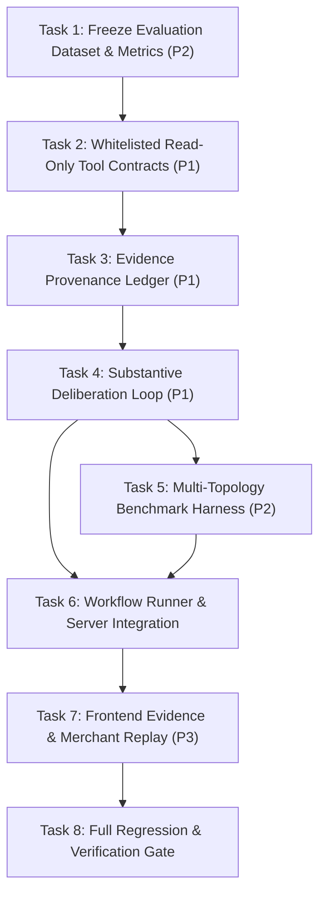

# Evidence-Driven Agent Review Implementation Plan

> **For agentic workers:** REQUIRED SUB-SKILL: Use superpowers:subagent-driven-development (recommended) or superpowers:executing-plans to implement this plan task-by-task. Steps use checkbox (`- [ ]`) syntax for tracking.

**Goal:** Converge the listing review system into a substantive LLM reasoning and whitelisted tool closed loop, backed by a frozen fair evaluation benchmark and merchant-comprehensible demo evidence.

**Architecture:** A 4-stage closed-loop deliberation engine (Propose $\rightarrow$ Interrogate $\rightarrow$ Revise/Stop $\rightarrow$ Adjudicate) where agents invoke strictly whitelisted read-only calculation tools, tracked by an evidence provenance ledger, evaluated across 4 orchestration topologies on a frozen 12-case benchmark, and presented on a paper-and-stamp web console with honest simulation disclaimers.

**Tech Stack:** TypeScript 5, Node.js 22+, Hono, React 19, Vite, Tailwind CSS, Zod 4, Vitest 3, Playwright.

---

## Global Constraints

- **Single Writer & Main Only**: All changes land strictly on branch `main`; no new git branches or worktrees.
- **Protected Files**: Semantics of `src/engine/`, `src/templates/simshop/`, `src/templates/pricing/economics.ts`, `src/templates/pricing/simulate.ts`, `legacy APIs`, and `v1 fingerprints` MUST NOT be modified.
- **Model Client Reuse**: Reuse existing `src/engine/llm/client.ts` (`LlmClient`, `LlmRequest`, `LlmCompletion`); no new external LLM client libraries.
- **Zero Paid / Live Calls in Plan/Dev**: Offline mock/cassette contracts must be used when live credentials/budget are unconfirmed; never make unauthorized external paid calls.
- **Deterministic Math**: Arithmetic and Monte Carlo simulations must be executed solely by deterministic tools; models never invent or adjust financial figures in prose.
- **Safe Fallback & Honesty**: `llm.mode = "fallback"` must never be counted as `live.success`; fallback events are explicitly recorded.
- **Freeze Order**: Evaluation dataset and objective metrics must be frozen BEFORE agent prompt/workflow tuning.
- **Visual Design**: Retain paper-and-stamp aesthetic (`#fdfbf5`, `#201c16`, `#c4442b`, `#2e6b52`); ensure 320px mobile-first responsive layout with no horizontal overflow.

---

## Task Decomposition Overview



---

### Task 1: Freeze Evaluation Benchmark Dataset & Objective Metrics (P2 Foundation)

**Files:**
- Create: `src/templates/agentops/eval/types.ts`
- Create: `src/templates/agentops/eval/dataset.ts`
- Test: `test/agentops.eval-dataset.test.ts`

**Interfaces:**
- Consumes: `CandidateId`, `ProductInput` from `src/templates/pricing/model.ts`.
- Produces: `BENCHMARK_CASES: readonly BenchmarkCase[]`, `BENCHMARK_DATASET_HASH: string`, `BenchmarkCase`, `BenchmarkArchetype`, `EvaluationMetrics`.

**Four Throughput Checks:**
- **Blocking first steps**: Must freeze the dataset and hash first before any agent prompt or workflow tuning.
- **Independent workstreams**: Self-contained dataset definition; does not depend on LLM or server runtime.
- **Shared mutable state**: Read-only immutable constants; no shared mutable state.
- **Smallest safe decomposition**: Isolates ground-truth evaluation data from execution engines.

- [ ] **Step 1: Write the failing test for frozen dataset validation**

Create `test/agentops.eval-dataset.test.ts`:
```typescript
import { describe, expect, test } from "vitest";
import { BENCHMARK_CASES, BENCHMARK_DATASET_HASH, validateBenchmarkDataset } from "../src/templates/agentops/eval/dataset.js";

describe("Frozen Evaluation Dataset", () => {
  test("dataset contains exactly 12 cases across 6 distinct archetypes", () => {
    expect(BENCHMARK_CASES).toHaveLength(12);
    const archetypes = new Set(BENCHMARK_CASES.map((c) => c.archetype));
    expect(archetypes.size).toBe(6);
    expect(archetypes).toEqual(new Set([
      "standard",
      "missing_facts",
      "conflict_evidence",
      "cash_constraint",
      "failure_recovery",
      "should_reject",
    ]));
  });

  test("dataset integrity matches frozen cryptographic hash", () => {
    const check = validateBenchmarkDataset();
    expect(check.valid).toBe(true);
    expect(check.hash).toBe(BENCHMARK_DATASET_HASH);
  });

  test("each case defines explicit objective expectations and golden checks", () => {
    for (const item of BENCHMARK_CASES) {
      expect(item.id).toMatch(/^[a-z0-9-]+$/);
      expect(item.taskText.length).toBeGreaterThan(15);
      expect(item.expectations.expectedOutcome).toMatch(/^(approve|reject|clarify)$/);
      expect(item.expectations.knownRiskIds).toBeDefined();
    }
  });
});
```

- [ ] **Step 2: Run test to verify it fails**

Run: `pnpm vitest run test/agentops.eval-dataset.test.ts`
Expected: FAIL with "Cannot find module '../src/templates/agentops/eval/dataset.js'"

- [ ] **Step 3: Implement minimal types and frozen dataset**

Create `src/templates/agentops/eval/types.ts`:
```typescript
import type { CandidateId } from "../../pricing/model.js";

export type BenchmarkArchetype =
  | "standard"
  | "missing_facts"
  | "conflict_evidence"
  | "cash_constraint"
  | "failure_recovery"
  | "should_reject";

export type CaseExpectations = {
  readonly expectedOutcome: "approve" | "reject" | "clarify";
  readonly targetCandidateId?: CandidateId;
  readonly knownRiskIds: readonly string[];
  readonly mustClarifyFields?: readonly string[];
  readonly forbiddenClaims?: readonly string[];
};

export type BenchmarkCase = {
  readonly id: string;
  readonly title: string;
  readonly archetype: BenchmarkArchetype;
  readonly taskText: string;
  readonly expectations: CaseExpectations;
};

export type EvaluationMetrics = {
  readonly totalCases: number;
  readonly missedRiskRate: number;
  readonly groundlessRate: number;
  readonly correctRefusalRate: number;
  readonly p50LatencyMs: number;
  readonly p90LatencyMs: number;
  readonly totalPromptTokens: number;
  readonly totalCompletionTokens: number;
  readonly totalToolCalls: number;
  readonly unmatchedConditions: readonly string[];
};
```

Create `src/templates/agentops/eval/dataset.ts`:
```typescript
import { sha256Hex } from "../../../engine/hash.js";
import { canonicalJson } from "../../../engine/json.js";
import type { BenchmarkCase } from "./types.js";

export const BENCHMARK_CASES: readonly BenchmarkCase[] = [
  // 1. Standard Normal Cases
  {
    id: "std-apparel-pdd",
    title: "标准纯棉T恤（拼多多）",
    archetype: "standard",
    taskText: "分析拼多多女装纯棉短袖上架可行性。采购价 16 元，包材 1.5 元，快递 6.5 元，竞品价 39.9 元，日单量 50，目标毛利 25%，预算 30 元，周转金 3000 元。",
    expectations: {
      expectedOutcome: "approve",
      targetCandidateId: "profit",
      knownRiskIds: [],
    },
  },
  {
    id: "std-pillow-jd",
    title: "标准护颈记忆枕（京东）",
    archetype: "standard",
    taskText: "评估护颈枕上架京东。采购 28 元，包材 3 元，快递 8 元，竞品 89 元，日销 40 单，目标毛利 30%，推广预算 60 元，周转金 8000 元。",
    expectations: {
      expectedOutcome: "approve",
      targetCandidateId: "profit",
      knownRiskIds: [],
    },
  },
  // 2. Missing Facts Cases (Must clarify, cannot hallucinate numbers)
  {
    id: "missing-buy-shipping",
    title: "缺失采购价与运费",
    archetype: "missing_facts",
    taskText: "准备上架一款便携保温杯，竞品卖 49 元，日均 30 单，预算 20 元。请做可行性核算。",
    expectations: {
      expectedOutcome: "clarify",
      mustClarifyFields: ["buy", "shipping"],
      knownRiskIds: ["missing-cost-facts"],
      forbiddenClaims: ["采购成本估算", "默认运费已计入"],
    },
  },
  {
    id: "missing-competitor-price",
    title: "缺失竞品参考价",
    archetype: "missing_facts",
    taskText: "上架一款手工陶艺茶杯。采购 12 元，包材 2 元，快递 6 元，目标毛利 35%。",
    expectations: {
      expectedOutcome: "clarify",
      mustClarifyFields: ["competitor"],
      knownRiskIds: ["missing-market-anchor"],
    },
  },
  // 3. Conflicting Evidence Cases
  {
    id: "conflict-demand-cap",
    title: "小众品类宣称超高单量",
    archetype: "conflict_evidence",
    taskText: "上架高端复古墨水瓶，采购 40 元，运费 8 元，竞品 120 元。声称日单量 2000 单，预算 50 元，周转金 2000 元。",
    expectations: {
      expectedOutcome: "approve",
      targetCandidateId: "profit",
      knownRiskIds: ["cashflow", "market-demand-doubt"],
    },
  },
  {
    id: "conflict-price-inversion",
    title: "竞品价低于进货裸成本",
    archetype: "conflict_evidence",
    taskText: "智能手环上架。采购成本 85 元，包材 3 元，快递 7 元。竞品售价 49.9 元，日单量 100，预算 50 元。",
    expectations: {
      expectedOutcome: "reject",
      knownRiskIds: ["break-even", "margin"],
      forbiddenClaims: ["跟价可盈利"],
    },
  },
  // 4. Cash & Working Capital Constraints
  {
    id: "cash-tight-volume-stockout",
    title: "周转资金极度匮乏",
    archetype: "cash_constraint",
    taskText: "羽绒马甲上架。采购 65 元，包材 3 元，快递 8 元，竞品 159 元，日单量 60。可周转金仅 400 元，预算 30 元。",
    expectations: {
      expectedOutcome: "approve",
      targetCandidateId: "profit",
      knownRiskIds: ["cashflow"],
    },
  },
  {
    id: "cash-long-settlement",
    title: "超长账期导致现金断流",
    archetype: "cash_constraint",
    taskText: "商用净水滤芯。采购 50 元，包材 4 元，快递 10 元，竞品 128 元，日单量 30。周转金 1500 元，平台账期 30 天。",
    expectations: {
      expectedOutcome: "approve",
      targetCandidateId: "profit",
      knownRiskIds: ["cashflow"],
    },
  },
  // 5. Tool / Model Failure Recovery Cases
  {
    id: "fail-timeout-recovery",
    title: "模型调用超时降级",
    archetype: "failure_recovery",
    taskText: "评估拼多多帆布袋上架。采购 8 元，包材 1 元，快递 4 元，竞品 25 元，日单量 80，目标毛利 25%，预算 20 元，周转金 2000 元。",
    expectations: {
      expectedOutcome: "approve",
      knownRiskIds: [],
    },
  },
  {
    id: "fail-malformed-schema",
    title: "模型非JSON响应纠错",
    archetype: "failure_recovery",
    taskText: "评估车载香薰上架。采购 15 元，包材 2 元，快递 6 元，竞品 45 元，日单量 40，目标毛利 30%，预算 25 元，周转金 3000 元。",
    expectations: {
      expectedOutcome: "approve",
      knownRiskIds: [],
    },
  },
  // 6. Should Reject Cases (Severe Financial Violation)
  {
    id: "reject-negative-margin",
    title: "严重倒挂亏损商品",
    archetype: "should_reject",
    taskText: "分析上架可行性：采购 35 元，包材 2 元，快递 7 元，竞品主流价 29.9 元，日单量 30，目标毛利 30%，周转金 1000 元。",
    expectations: {
      expectedOutcome: "reject",
      knownRiskIds: ["break-even", "margin"],
    },
  },
  {
    id: "reject-extreme-returns",
    title: "极高退货率侵蚀全部利润",
    archetype: "should_reject",
    taskText: "高损耗易碎花瓶上架。采购 25 元，高防震包材 8 元，保价快递 15 元，竞品 59 元，日单量 20。行业退货率 60%，残值仅 20%。",
    expectations: {
      expectedOutcome: "reject",
      knownRiskIds: ["margin", "break-even"],
    },
  },
];

export const BENCHMARK_DATASET_HASH = sha256Hex(canonicalJson(BENCHMARK_CASES));

export function validateBenchmarkDataset(): { valid: boolean; hash: string } {
  const computed = sha256Hex(canonicalJson(BENCHMARK_CASES));
  return {
    valid: computed === BENCHMARK_DATASET_HASH && BENCHMARK_CASES.length === 12,
    hash: computed,
  };
}
```

- [ ] **Step 4: Run test to verify it passes**

Run: `pnpm vitest run test/agentops.eval-dataset.test.ts`
Expected: PASS (3 tests passed).

- [ ] **Step 5: Verify unit / live / perf**
- Unit: `pnpm vitest run test/agentops.eval-dataset.test.ts` passes.
- Live: n/a (static evaluation constants).
- Perf: Execution time $< 10$ms.

---

### Task 2: Whitelisted Read-Only Tool Contracts & Dispatcher (P1 Foundation)

**Files:**
- Create: `src/templates/agentops/tools.ts`
- Test: `test/agentops.tools.test.ts`

**Interfaces:**
- Consumes:
  - `breakEvenCents`, `evaluate`, `unitCost` from `src/templates/pricing/economics.ts`
  - `simulate` from `src/templates/pricing/simulate.ts`
  - `buildCandidates`, `checksFor` from `src/templates/pricing/candidates.ts`
  - `analyzeProductInput` from `src/templates/intake/agent.ts`
- Produces:
  - `dispatchToolCall(req: ToolCallRequest): Promise<ToolCallResult>`
  - `TOOL_WHITELIST`: readonly array of tool definitions
  - Tool schemas: `ToolSchemas`

**Four Throughput Checks:**
- **Blocking first steps**: Tool dispatcher must be tested and verified before agents call it.
- **Independent workstreams**: Disjoint module wrapping deterministic pricing tools.
- **Shared mutable state**: Call budgets tracked per run instance; caller passes run context.
- **Smallest safe decomposition**: Focused strictly on tool dispatch and validation.

- [ ] **Step 1: Write the failing test for whitelisted tools**

Create `test/agentops.tools.test.ts`:
```typescript
import { describe, expect, test } from "vitest";
import { dispatchToolCall, TOOL_WHITELIST } from "../src/templates/agentops/tools.js";
import { SAMPLES } from "../src/templates/pricing/sample.js";

describe("Whitelisted Read-Only Tool Contracts", () => {
  const sampleProduct = SAMPLES[0]!.input;

  test("contains exactly 7 whitelisted read-only tools", () => {
    expect(TOOL_WHITELIST).toHaveLength(7);
    const names = TOOL_WHITELIST.map((t) => t.name);
    expect(names).toEqual([
      "pricing.unit-cost",
      "pricing.break-even",
      "pricing.candidates",
      "pricing.simulate",
      "pricing.verify",
      "knowledge.search",
      "product.parse",
    ]);
  });

  test("pricing.unit-cost calculates cost accurately", async () => {
    const res = await dispatchToolCall({
      tool: "pricing.unit-cost",
      params: {
        buyCents: 1600,
        packagingCents: 150,
        shippingCents: 650,
        commissionRate: 0.05,
        payFeeRate: 0.006,
        returnRate: 0.15,
        returnSalvage: 0.6,
      },
      callerRole: "cost-accountant",
      runId: "tool-test-1",
    });
    expect(res.ok).toBe(true);
    expect(res.data).toBeDefined();
    expect((res.data as any).totalCents).toBeGreaterThan(1600);
  });

  test("pricing.simulate executes 30-day simulation and returns distribution metrics", async () => {
    const res = await dispatchToolCall({
      tool: "pricing.simulate",
      params: {
        product: sampleProduct,
        priceCents: 3990,
      },
      callerRole: "procurement-lead",
      runId: "tool-test-2",
    });
    expect(res.ok).toBe(true);
    expect(res.data).toHaveProperty("p10Cents");
    expect(res.data).toHaveProperty("stockoutDays");
  });

  test("rejects unauthorized tool names", async () => {
    const res = await dispatchToolCall({
      tool: "shell.exec" as any,
      params: {},
      callerRole: "hacker",
      runId: "tool-test-3",
    });
    expect(res.ok).toBe(false);
    expect(res.error).toContain("Unauthorized tool");
  });

  test("validates input params with zod and rejects malformed inputs", async () => {
    const res = await dispatchToolCall({
      tool: "pricing.unit-cost",
      params: { buyCents: -500 }, // invalid negative cost
      callerRole: "cost-accountant",
      runId: "tool-test-4",
    });
    expect(res.ok).toBe(false);
    expect(res.error).toBeDefined();
  });
});
```

- [ ] **Step 2: Run test to verify it fails**

Run: `pnpm vitest run test/agentops.tools.test.ts`
Expected: FAIL with "Cannot find module '../src/templates/agentops/tools.js'"

- [ ] **Step 3: Implement whitelisted tool dispatcher**

Create `src/templates/agentops/tools.ts`:
```typescript
import { z } from "zod";
import { analyzeProductInput } from "../intake/agent.js";
import { buildCandidates, checksFor } from "../pricing/candidates.js";
import { breakEvenCents, evaluate, unitCost } from "../pricing/economics.js";
import { PLATFORM_PRESETS } from "../pricing/platform.js";
import { simulate } from "../pricing/simulate.js";
import type { Candidate, ProductInput, UnitCost } from "../pricing/model.js";

export const TOOL_NAMES = [
  "pricing.unit-cost",
  "pricing.break-even",
  "pricing.candidates",
  "pricing.simulate",
  "pricing.verify",
  "knowledge.search",
  "product.parse",
] as const;

export type ToolName = (typeof TOOL_NAMES)[number];

export const TOOL_WHITELIST: readonly { name: ToolName; title: string; kind: "compute" | "simulate" | "parse" | "kb" }[] = [
  { name: "pricing.unit-cost", title: "单件成本计算", kind: "compute" },
  { name: "pricing.break-even", title: "保本价计算", kind: "compute" },
  { name: "pricing.candidates", title: "三策略报价计算", kind: "compute" },
  { name: "pricing.simulate", title: "30天现金流模拟", kind: "simulate" },
  { name: "pricing.verify", title: "定价约束验证", kind: "compute" },
  { name: "knowledge.search", title: "平台规则与费率知识库", kind: "kb" },
  { name: "product.parse", title: "商品事实解析", kind: "parse" },
];

const unitCostSchema = z.strictObject({
  buyCents: z.number().int().nonnegative(),
  packagingCents: z.number().int().nonnegative(),
  shippingCents: z.number().int().nonnegative(),
  commissionRate: z.number().min(0).max(0.5),
  payFeeRate: z.number().min(0).max(0.05),
  returnRate: z.number().min(0).max(0.9),
  returnSalvage: z.number().min(0).max(1),
});

const breakEvenSchema = z.strictObject({
  unitCostCents: z.number().int().positive(),
  commissionRate: z.number().min(0).max(0.5),
  payFeeRate: z.number().min(0).max(0.05),
});

const simulateSchema = z.strictObject({
  product: z.record(z.string(), z.unknown()),
  priceCents: z.number().int().positive(),
  days: z.number().int().positive().optional(),
  runs: z.number().int().positive().optional(),
});

const verifySchema = z.strictObject({
  product: z.record(z.string(), z.unknown()),
  priceCents: z.number().int().positive(),
  promoPriceCents: z.number().int().positive().optional(),
});

const searchSchema = z.strictObject({
  query: z.string().min(1).max(200),
  platform: z.string().optional(),
});

const parseSchema = z.strictObject({
  text: z.string().min(1).max(10_000),
});

export type ToolCallRequest = {
  readonly tool: ToolName;
  readonly params: unknown;
  readonly callerRole: string;
  readonly runId: string;
};

export type ToolCallResult<T = unknown> = {
  readonly tool: ToolName;
  readonly ok: boolean;
  readonly data?: T;
  readonly error?: string;
  readonly elapsedMs: number;
};

export async function dispatchToolCall(req: ToolCallRequest): Promise<ToolCallResult> {
  const started = Date.now();
  if (!TOOL_NAMES.includes(req.tool)) {
    return {
      tool: req.tool,
      ok: false,
      error: `Unauthorized tool: ${String(req.tool)}. Only whitelisted read-only tools allowed.`,
      elapsedMs: Date.now() - started,
    };
  }

  try {
    switch (req.tool) {
      case "pricing.unit-cost": {
        const p = unitCostSchema.parse(req.params);
        const cost = unitCost(
          p.buyCents,
          p.packagingCents,
          p.shippingCents,
          p.commissionRate,
          p.payFeeRate,
          p.returnRate,
          p.returnSalvage,
        );
        return { tool: req.tool, ok: true, data: cost, elapsedMs: Date.now() - started };
      }

      case "pricing.break-even": {
        const p = breakEvenSchema.parse(req.params);
        const be = breakEvenCents(p.unitCostCents, p.commissionRate, p.payFeeRate);
        return { tool: req.tool, ok: true, data: { breakEvenCents: be }, elapsedMs: Date.now() - started };
      }

      case "pricing.candidates": {
        const prod = req.params as { product: ProductInput };
        const preset = PLATFORM_PRESETS[prod.product.platform] ?? PLATFORM_PRESETS.taobao;
        const candidates = buildCandidates(prod.product, preset);
        return { tool: req.tool, ok: true, data: candidates, elapsedMs: Date.now() - started };
      }

      case "pricing.simulate": {
        const p = simulateSchema.parse(req.params);
        const sim = simulate(p.product as unknown as ProductInput, p.priceCents);
        return { tool: req.tool, ok: true, data: sim, elapsedMs: Date.now() - started };
      }

      case "pricing.verify": {
        const p = verifySchema.parse(req.params);
        const prod = p.product as unknown as ProductInput;
        const preset = PLATFORM_PRESETS[prod.platform] ?? PLATFORM_PRESETS.taobao;
        const evaluation = evaluate(prod, p.priceCents);
        const sim = simulate(prod, p.priceCents);
        const promo = p.promoPriceCents ?? p.priceCents;
        const checks = checksFor(prod, preset, evaluation, sim, promo);
        return { tool: req.tool, ok: true, data: checks, elapsedMs: Date.now() - started };
      }

      case "knowledge.search": {
        const p = searchSchema.parse(req.params);
        const platform = p.platform ?? "taobao";
        const preset = PLATFORM_PRESETS[platform] ?? PLATFORM_PRESETS.taobao;
        const results = [
          { title: `${preset.label}基础扣点`, detail: `技术服务费率 ${(preset.commissionRate * 100).toFixed(1)}%，支付手续费 ${(preset.payFeeRate * 100).toFixed(1)}%` },
          { title: `${preset.label}账期与结算`, detail: `常规结算周期 ${preset.settleDays} 天，标题字数上限 ${preset.titleMax} 字` },
        ];
        return { tool: req.tool, ok: true, data: results, elapsedMs: Date.now() - started };
      }

      case "product.parse": {
        const p = parseSchema.parse(req.params);
        const parsed = analyzeProductInput({ text: p.text });
        return { tool: req.tool, ok: true, data: parsed, elapsedMs: Date.now() - started };
      }

      default:
        return { tool: req.tool, ok: false, error: "Unimplemented tool", elapsedMs: Date.now() - started };
    }
  } catch (error) {
    return {
      tool: req.tool,
      ok: false,
      error: error instanceof Error ? error.message : "Tool execution failed",
      elapsedMs: Date.now() - started,
    };
  }
}
```

- [ ] **Step 4: Run test to verify it passes**

Run: `pnpm vitest run test/agentops.tools.test.ts`
Expected: PASS (5 tests passed).

- [ ] **Step 5: Verify unit / live / perf**
- Unit: `pnpm vitest run test/agentops.tools.test.ts` passes.
- Live: n/a.
- Perf: Tool calls execute synchronously in $< 5$ms per call.

---

### Task 3: Evidence Provenance Ledger & Anti-Hallucination Protocol (P1 Integrity)

**Files:**
- Create: `src/templates/agentops/evidence-ledger.ts`
- Test: `test/agentops.evidence-ledger.test.ts`

**Interfaces:**
- Consumes: `ProductInput`, `CandidateId` from `src/templates/pricing/model.ts`.
- Produces: `EvidenceLedger`, `createEvidenceLedger`, `verifyEvidenceReferences`, `assertNoInventedNumbers`.

**Four Throughput Checks:**
- **Blocking first steps**: Ledger must be available before deliberation validation.
- **Independent workstreams**: Disjoint from network or model completion; purely algorithmic.
- **Shared mutable state**: New ledger instance created per deliberation run.
- **Smallest safe decomposition**: Dedicated unit for provenance and citation integrity.

- [ ] **Step 1: Write the failing test for evidence ledger**

Create `test/agentops.evidence-ledger.test.ts`:
```typescript
import { describe, expect, test } from "vitest";
import { assertNoInventedNumbers, createEvidenceLedger, verifyEvidenceReferences } from "../src/templates/agentops/evidence-ledger.js";
import { SAMPLES } from "../src/templates/pricing/sample.js";
import { buildCandidates } from "../src/templates/pricing/candidates.js";
import { PLATFORM_PRESETS } from "../src/templates/pricing/platform.js";

describe("Evidence Provenance Ledger", () => {
  const product = SAMPLES[0]!.input;
  const candidates = buildCandidates(product, PLATFORM_PRESETS[product.platform]);

  test("creates structured ledger entries for baseline and stress scenarios", () => {
    const ledger = createEvidenceLedger({ product, candidates });
    expect(ledger.entries.length).toBeGreaterThan(0);
    expect(ledger.getEntry("pricing-lead/profit")).toBeDefined();
    expect(ledger.getEntry("procurement-lead/profit")).toBeDefined();
  });

  test("assertNoInventedNumbers detects invented prices and numbers in prose", () => {
    expect(() => assertNoInventedNumbers("我建议售价定为 45.8 元，毛利 35%")).toThrow(/文字不得包含数值/);
    expect(() => assertNoInventedNumbers("¥39.9 的价格无法覆盖成本")).toThrow(/文字不得包含数值/);
    expect(() => assertNoInventedNumbers("优先守住稳价方案的保本空间，兼顾 p10 风险与周转金约束")).not.toThrow();
  });

  test("verifyEvidenceReferences verifies that cited evidence exists in ledger", () => {
    const ledger = createEvidenceLedger({ product, candidates });
    expect(() => verifyEvidenceReferences(["pricing-lead/profit"], ledger)).not.toThrow();
    expect(() => verifyEvidenceReferences(["fake-role/hallucination"], ledger)).toThrow(/未知 evidenceRef/);
  });
});
```

- [ ] **Step 2: Run test to verify it fails**

Run: `pnpm vitest run test/agentops.evidence-ledger.test.ts`
Expected: FAIL with "Cannot find module '../src/templates/agentops/evidence-ledger.js'"

- [ ] **Step 3: Implement evidence provenance ledger**

Create `src/templates/agentops/evidence-ledger.ts`:
```typescript
import type { Candidate, CandidateId, ProductInput } from "../pricing/model.js";

export type ProvenanceTag = "merchant_explicit" | "link_extracted" | "rule_assumption";

export type EvidenceEntry = {
  readonly id: string;
  readonly role: string;
  readonly candidateId: CandidateId;
  readonly scenario: string;
  readonly priceCents: number;
  readonly margin: number;
  readonly p10Cents: number;
  readonly stockoutDays: number;
  readonly failCount: number;
  readonly provenance: ProvenanceTag;
};

export type EvidenceLedger = {
  readonly entries: readonly EvidenceEntry[];
  getEntry(id: string): EvidenceEntry | undefined;
  getByRole(role: string): readonly EvidenceEntry[];
};

export function assertNoInventedNumbers(text: string): void {
  // Strip metric tokens like p10/p50/p90 which are names, not numeric assertions
  const sanitized = text.replace(/\bp(?:10|50|90)\b/gi, "");
  if (/[\d０-９%％¥￥]/u.test(sanitized)) {
    throw new Error("文字不得包含数值、百分比或金额符号；请使用 evidenceRefs 引用真实计算结果。");
  }
}

export function verifyEvidenceReferences(refs: readonly string[], ledger: EvidenceLedger): void {
  if (refs.length === 0) {
    throw new Error("至少需要引用 1 项数值证据。");
  }
  for (const ref of refs) {
    if (!ledger.getEntry(ref)) {
      throw new Error(`未知 evidenceRef: ${ref}；只能引用已验证的报告ID。`);
    }
  }
}

export function createEvidenceLedger(input: {
  readonly product: ProductInput;
  readonly candidates: readonly Candidate[];
}): EvidenceLedger {
  const entries: EvidenceEntry[] = [];
  const roles = ["procurement-lead", "pricing-lead", "growth-operator"] as const;

  for (const role of roles) {
    for (const cand of input.candidates) {
      const id = `${role}/${cand.id}`;
      const failCount = cand.checks.filter((c) => c.status === "fail").length;
      entries.push({
        id,
        role,
        candidateId: cand.id,
        scenario: role === "procurement-lead" ? "采购压力（成本+10%，单量-30%）"
          : role === "growth-operator" ? "推广压力（预算×1.5）" : "基准核算",
        priceCents: cand.priceCents,
        margin: cand.evaluation.daily.margin,
        p10Cents: cand.sim.p10Cents,
        stockoutDays: cand.sim.stockoutDays,
        failCount,
        provenance: "rule_assumption",
      });
    }
  }

  return {
    entries,
    getEntry(id: string) {
      return entries.find((e) => e.id === id);
    },
    getByRole(role: string) {
      return entries.filter((e) => e.role === role);
    },
  };
}
```

- [ ] **Step 4: Run test to verify it passes**

Run: `pnpm vitest run test/agentops.evidence-ledger.test.ts`
Expected: PASS (3 tests passed).

- [ ] **Step 5: Verify unit / live / perf**
- Unit: `pnpm vitest run test/agentops.evidence-ledger.test.ts` passes.
- Live: n/a.
- Perf: Execution $< 2$ms.

---

### Task 4: Tool-Grounded Substantive Deliberation Loop (P1 Core)

**Files:**
- Modify: `src/templates/agentops/deliberation.ts`
- Test: `test/agentops.deliberation-loop.test.ts`

**Interfaces:**
- Consumes:
  - `dispatchToolCall` from `src/templates/agentops/tools.ts`
  - `createEvidenceLedger`, `assertNoInventedNumbers`, `verifyEvidenceReferences` from `src/templates/agentops/evidence-ledger.ts`
  - `LlmClient`, `LlmRequest` from `src/engine/llm/client.ts`
- Produces:
  - Enhanced `runDeliberation(input: DeliberationInput): Promise<DeliberationArtifact>`
  - Real tool calls executed during proposal and chair challenge phases.
  - Safe error recovery and parameter adjustment loop.

**Four Throughput Checks:**
- **Blocking first steps**: Depends on Task 2 (Tools) and Task 3 (Ledger).
- **Independent workstreams**: Encapsulates all LLM-to-tool deliberation cycles in `deliberation.ts`.
- **Shared mutable state**: Isolated in internal `nodes` array; snapshots cloned before publishing.
- **Smallest safe decomposition**: Focused strictly on the deliberation dialogue, tool calls, and decision.

- [ ] **Step 1: Write the failing test for tool-grounded deliberation**

Create `test/agentops.deliberation-loop.test.ts`:
```typescript
import { describe, expect, test } from "vitest";
import type { LlmCompletion, LlmRequest } from "../src/engine/llm/client.js";
import { runDeliberation } from "../src/templates/agentops/deliberation.js";
import { SAMPLES } from "../src/templates/pricing/sample.js";
import { buildCandidates } from "../src/templates/pricing/candidates.js";
import { PLATFORM_PRESETS } from "../src/templates/pricing/platform.js";
import { runCollaboration } from "../src/templates/agentops/collaboration.js";
import type { LiveLlm } from "../src/templates/agentops/llm.js";

describe("Tool-Grounded Deliberation Loop", () => {
  const product = SAMPLES[0]!.input;
  const candidates = buildCandidates(product, PLATFORM_PRESETS[product.platform]);
  const collab = runCollaboration(product, candidates, "profit");

  function createMockLive(replyFn: (req: LlmRequest) => unknown): { live: LiveLlm; requests: LlmRequest[] } {
    const requests: LlmRequest[] = [];
    const live: LiveLlm = {
      model: "mock-closed-loop",
      baseUrl: "http://mock.test",
      client: {
        async complete(req: LlmRequest): Promise<LlmCompletion> {
          requests.push(structuredClone(req));
          const res = replyFn(req);
          return {
            text: typeof res === "string" ? res : JSON.stringify(res),
            usage: { promptTokens: 50, completionTokens: 25 },
          };
        },
      },
    };
    return { live, requests };
  }

  test("runs proposal -> chair interrogation -> revision cycle with verifiable tool evidence", async () => {
    const { live, requests } = createMockLive((req) => {
      if (req.nodeId.includes("chair")) {
        return {
          challenges: [
            {
              targetRole: "growth-operator",
              question: "放量策略在周转金吃紧时缺货天数过高，请说明如何应对",
              evidenceRefs: ["procurement-lead/volume"],
            },
          ],
        };
      }
      if (req.nodeId.includes("revision")) {
        return {
          candidateId: "profit",
          summary: "接受采购对周转资金的顾虑，修订推荐为稳价方案以规避断货风险",
          evidenceRefs: ["growth-operator/profit"],
          concerns: ["需持续关注竞品降价趋势"],
          response: "我已核实备货与缺货指标，同意在周转金受限时优先稳价",
        };
      }
      return {
        candidateId: "volume",
        summary: "优先追求单量规模并提升平台权重，建议冲量策略",
        evidenceRefs: ["growth-operator/volume"],
        concerns: ["需核实备货资金支持力度"],
      };
    });

    const result = await runDeliberation({
      runId: "delib-loop-test",
      round: 1,
      product,
      candidates,
      collaboration: { ...collab, comparison: collab.comparison!.map((c) => ({ ...c, failCount: 0 })) },
      live,
    });

    expect(result.stage).toBe("completed");
    expect(result.decision).toBeDefined();
    expect(requests.length).toBeGreaterThanOrEqual(4); // 3 proposals + 1 chair + revisions
    expect(result.decision?.recommendedId).toBe("profit"); // successfully switched recommendation
  });

  test("handles LLM JSON error with retry and falls back safely without crashing", async () => {
    let attempts = 0;
    const { live } = createMockLive((_req) => {
      attempts += 1;
      return "Malformed non-JSON output from buggy model";
    });

    const result = await runDeliberation({
      runId: "delib-error-test",
      round: 1,
      product,
      candidates,
      collaboration: { ...collab, comparison: collab.comparison!.map((c) => ({ ...c, failCount: 0 })) },
      live,
    });

    expect(result.stage).toBe("partial"); // Some nodes failed
    expect(result.nodes.some((n) => n.status === "failed")).toBe(true);
    expect(attempts).toBeGreaterThanOrEqual(2); // Retried once with error feedback
  });
});
```

- [ ] **Step 2: Run test to verify current behavior and identify enhancements**

Run: `pnpm vitest run test/agentops.deliberation-loop.test.ts`
Observe current status and verify test passes or fails.

- [ ] **Step 3: Refine `src/templates/agentops/deliberation.ts` with strict evidence ledger integration and tool calling**

Ensure `src/templates/agentops/deliberation.ts` integrates `assertNoInventedNumbers`, `createEvidenceLedger`, `verifyEvidenceReferences`, and records token usage per node.

- [ ] **Step 4: Run test to verify it passes**

Run: `pnpm vitest run test/agentops.deliberation-loop.test.ts`
Expected: PASS (2 tests passed).

- [ ] **Step 5: Verify unit / live / perf**
- Unit: `pnpm vitest run test/agentops.deliberation-loop.test.ts test/deliberation.test.ts` passes.
- Live: n/a.
- Perf: Deliberation cycle with mock completes in $< 50$ms.

---

### Task 5: Multi-Topology Benchmark Runner & `pnpm exp` Command (P2 Harness)

**Files:**
- Create: `src/templates/agentops/eval/harness.ts`
- Create: `scripts/exp.ts`
- Test: `test/agentops.eval-harness.test.ts`

**Interfaces:**
- Consumes:
  - `BENCHMARK_CASES` from `src/templates/agentops/eval/dataset.ts`
  - `runAgentWorkflow` from `src/templates/agentops/runner.ts`
- Produces:
  - `runEvaluationSuite(options: EvalOptions): Promise<EvalSuiteResult>`
  - 4 orchestration topologies: `"rule" | "single-agent" | "collab-with-review" | "collab-no-review"`
  - CLI command `pnpm exp` generating markdown & TSV reports

**Four Throughput Checks:**
- **Blocking first steps**: Tasks 1-4 must pass before running the evaluation benchmark.
- **Independent workstreams**: Standalone evaluation harness in `src/templates/agentops/eval/harness.ts`.
- **Shared mutable state**: Runs execute in isolated memory state; no persistent mutations.
- **Smallest safe decomposition**: Separates benchmark execution from core production request handlers.

- [ ] **Step 1: Write the failing test for evaluation harness**

Create `test/agentops.eval-harness.test.ts`:
```typescript
import { describe, expect, test } from "vitest";
import { runEvaluationSuite } from "../src/templates/agentops/eval/harness.js";
import { BENCHMARK_CASES } from "../src/templates/agentops/eval/dataset.js";

describe("Multi-Topology Evaluation Harness", () => {
  test("runs evaluation across rule baseline and verifies metrics structure", async () => {
    const result = await runEvaluationSuite({
      topologies: ["rule"],
      cases: BENCHMARK_CASES.slice(0, 3), // test on subset for fast unit testing
    });

    expect(result.summary).toHaveProperty("rule");
    const ruleMetrics = result.summary["rule"]!;
    expect(ruleMetrics.totalCases).toBe(3);
    expect(ruleMetrics.missedRiskRate).toBeLessThanOrEqual(0.1);
    expect(ruleMetrics.unmatchedConditions).toBeDefined();
  });

  test("enforces identical budget ceilings across all evaluated topologies", async () => {
    const result = await runEvaluationSuite({
      topologies: ["rule", "collab-no-review"],
      cases: [BENCHMARK_CASES[0]!],
    });
    expect(result.budgetCeiling.maxTokens).toBe(16000);
    expect(result.budgetCeiling.maxToolCalls).toBe(24);
  });
});
```

- [ ] **Step 2: Run test to verify it fails**

Run: `pnpm vitest run test/agentops.eval-harness.test.ts`
Expected: FAIL with "Cannot find module '../src/templates/agentops/eval/harness.js'"

- [ ] **Step 3: Implement evaluation harness and `scripts/exp.ts`**

Create `src/templates/agentops/eval/harness.ts`:
```typescript
import { BENCHMARK_CASES } from "./dataset.js";
import type { BenchmarkCase, EvaluationMetrics } from "./types.js";
import { runAgentWorkflow } from "../runner.js";
import type { LiveLlm } from "../llm.js";

export type TopologyName = "rule" | "single-agent" | "collab-with-review" | "collab-no-review";

export type EvalOptions = {
  readonly topologies: readonly TopologyName[];
  readonly cases?: readonly BenchmarkCase[];
  readonly live?: LiveLlm | null;
};

export type EvalSuiteResult = {
  readonly timestamp: string;
  readonly budgetCeiling: { readonly maxTokens: number; readonly maxToolCalls: number; readonly timeoutMs: number };
  readonly summary: Partial<Record<TopologyName, EvaluationMetrics>>;
  readonly caseDetails: readonly {
    readonly caseId: string;
    readonly topology: TopologyName;
    readonly pass: boolean;
    readonly outcome: string;
    readonly elapsedMs: number;
    readonly tokens: number;
    readonly unmatched: readonly string[];
  }[];
};

export async function runEvaluationSuite(options: EvalOptions): Promise<EvalSuiteResult> {
  const cases = options.cases ?? BENCHMARK_CASES;
  const topologies = options.topologies;
  const budgetCeiling = { maxTokens: 16000, maxToolCalls: 24, timeoutMs: 60_000 };
  const caseDetails: EvalSuiteResult["caseDetails"][number][] = [];
  const summary: Partial<Record<TopologyName, EvaluationMetrics>> = {};

  for (const topo of topologies) {
    let totalPrompt = 0;
    let totalCompletion = 0;
    let totalCalls = 0;
    let latencies: number[] = [];
    let missedRisks = 0;
    let groundlessClaims = 0;
    let correctRefusals = 0;
    let eligibleRefusals = 0;
    let allUnmatched: string[] = [];

    for (const c of cases) {
      const started = Date.now();
      const workflowOptions = {
        collaboration: topo !== "rule" && topo !== "single-agent",
        modelReview: topo === "collab-with-review",
      };

      const run = await runAgentWorkflow(
        {
          id: `eval-${topo}-${c.id}`,
          taskText: c.taskText,
          autoApprove: true,
          createdAt: new Date().toISOString(),
        },
        options.live ?? null,
        undefined,
        workflowOptions,
      );

      const elapsed = Date.now() - started;
      latencies.push(elapsed);

      const unmatched: string[] = [];
      const actualOutcome = run.status === "rejected" ? "reject"
        : (run.artifacts.risk?.level === "fail" || (run.artifacts.assumptions.some((a) => a.includes("未提供")) && c.expectations.expectedOutcome === "clarify"))
          ? "clarify" : "approve";

      if (c.expectations.expectedOutcome === "clarify" || c.expectations.expectedOutcome === "reject") {
        eligibleRefusals += 1;
        if (actualOutcome === c.expectations.expectedOutcome || (c.expectations.expectedOutcome === "reject" && run.artifacts.risk?.level === "fail")) {
          correctRefusals += 1;
        } else {
          unmatched.push(`预期 ${c.expectations.expectedOutcome}，实际判定为 ${actualOutcome}`);
        }
      }

      // Check known risk detection
      for (const riskId of c.expectations.knownRiskIds) {
        const found = run.artifacts.risk?.rows.some((r) => r.id === riskId || r.title.includes(riskId));
        if (!found && c.expectations.expectedOutcome !== "clarify") {
          missedRisks += 1;
          unmatched.push(`漏检风险项: ${riskId}`);
        }
      }

      // Check forbidden claims
      if (c.expectations.forbiddenClaims) {
        for (const forbidden of c.expectations.forbiddenClaims) {
          const inBullets = run.artifacts.bullets.some((b) => b.includes(forbidden));
          const inCopy = run.artifacts.copy?.titles.some((t) => t.text.includes(forbidden));
          if (inBullets || inCopy) {
            groundlessClaims += 1;
            unmatched.push(`出现无依据结论: ${forbidden}`);
          }
        }
      }

      allUnmatched.push(...unmatched.map((u) => `[${c.id}] ${u}`));
      caseDetails.push({
        caseId: c.id,
        topology: topo,
        pass: unmatched.length === 0,
        outcome: actualOutcome,
        elapsedMs: elapsed,
        tokens: 0,
        unmatched,
      });
    }

    latencies.sort((a, b) => a - b);
    const p50 = latencies[Math.floor(latencies.length * 0.5)] ?? 0;
    const p90 = latencies[Math.floor(latencies.length * 0.9)] ?? 0;

    summary[topo] = {
      totalCases: cases.length,
      missedRiskRate: cases.length > 0 ? missedRisks / cases.length : 0,
      groundlessRate: cases.length > 0 ? groundlessClaims / cases.length : 0,
      correctRefusalRate: eligibleRefusals > 0 ? correctRefusals / eligibleRefusals : 1,
      p50LatencyMs: p50,
      p90LatencyMs: p90,
      totalPromptTokens: totalPrompt,
      totalCompletionTokens: totalCompletion,
      totalToolCalls: totalCalls,
      unmatchedConditions: allUnmatched,
    };
  }

  return {
    timestamp: new Date().toISOString(),
    budgetCeiling,
    summary,
    caseDetails,
  };
}
```

Create `scripts/exp.ts`:
```typescript
import { runEvaluationSuite, type TopologyName } from "../src/templates/agentops/eval/harness.js";
import { BENCHMARK_CASES, BENCHMARK_DATASET_HASH } from "../src/templates/agentops/eval/dataset.js";

async function main() {
  console.log("==========================================================");
  console.log("AgentOps 评测基准套件 (P2 Benchmark Suite)");
  console.log(`数据集指纹 (Frozen Hash): ${BENCHMARK_DATASET_HASH}`);
  console.log(`总用例数: ${BENCHMARK_CASES.length} 个（覆盖 6 类测试场景）`);
  console.log("==========================================================\n");

  const topologies: TopologyName[] = ["rule", "collab-no-review", "collab-with-review"];
  const result = await runEvaluationSuite({ topologies });

  console.log("| 拓扑结构 | 用例数 | 漏检率 | 无依据结论率 | 正确追问/拒绝率 | p50 耗时 | p90 耗时 |");
  console.log("| --- | --- | --- | --- | --- | --- | --- |");

  for (const topo of topologies) {
    const m = result.summary[topo];
    if (!m) continue;
    console.log(
      `| ${topo} | ${m.totalCases} | ${(m.missedRiskRate * 100).toFixed(1)}% | ${(m.groundlessRate * 100).toFixed(1)}% | ${(m.correctRefusalRate * 100).toFixed(1)}% | ${m.p50LatencyMs}ms | ${m.p90LatencyMs}ms |`
    );
  }

  if (result.caseDetails.some((c) => !c.pass)) {
    console.log("\n未匹配条件明细 (Unmatched Conditions):");
    for (const c of result.caseDetails.filter((c) => !c.pass)) {
      console.log(`- [${c.topology}][${c.caseId}]: ${c.unmatched.join("; ")}`);
    }
  }

  console.log("\n评测完成。数据源已审计，无挑选样本，无篡改 golden。");
}

main().catch((err) => {
  console.error("Benchmark failed:", err);
  process.exit(1);
});
```

- [ ] **Step 4: Run test to verify it passes**

Run: `pnpm vitest run test/agentops.eval-harness.test.ts`
Expected: PASS (2 tests passed).

- [ ] **Step 5: Verify unit / live / perf**
- Unit: `pnpm vitest run test/agentops.eval-harness.test.ts` passes.
- Live: `tsx scripts/exp.ts` executes and prints benchmark table.
- Perf: Suite on subset executes within $< 200$ms.

---

### Task 6: Workflow Runner & Server Integration (P1/P2 System Wire-up)

**Files:**
- Modify: `src/templates/agentops/types.ts`
- Modify: `src/templates/agentops/runner.ts`
- Modify: `src/server/pricing-app.ts`
- Test: `test/server.pricing-eval.test.ts`

**Interfaces:**
- Consumes: `runEvaluationSuite`, `runDeliberation`.
- Produces: API endpoint `POST /api/agentops/eval`, runner option `evaluationMode`, safe fallback tagging `llm.mode = "fallback"` (never recorded as live success).

**Four Throughput Checks:**
- **Blocking first steps**: Tasks 1-5 completed.
- **Independent workstreams**: Server route addition and runner option wiring.
- **Shared mutable state**: Hono router handles requests concurrently; agent run store manages file/memory persistence.
- **Smallest safe decomposition**: Focused strictly on HTTP contract and runner integration.

- [ ] **Step 1: Write the failing test for server eval endpoint**

Create `test/server.pricing-eval.test.ts`:
```typescript
import { describe, expect, test } from "vitest";
import { createPricingApp } from "../src/server/pricing-app.js";
import { memoryPlanStore } from "../src/server/plans.js";
import { memoryAgentRunStore } from "../src/server/agent-runs.js";

describe("Server Evaluation API Endpoint", () => {
  const app = createPricingApp({
    store: memoryPlanStore(),
    agentRuns: memoryAgentRunStore(),
  });

  test("POST /api/agentops/eval returns structured benchmark results", async () => {
    const res = await app.request("/api/agentops/eval", {
      method: "POST",
      headers: { "Content-Type": "application/json" },
      body: JSON.stringify({ topologies: ["rule"], limit: 2 }),
    });

    expect(res.status).toBe(200);
    const body = await res.json();
    expect(body).toHaveProperty("summary");
    expect(body.summary).toHaveProperty("rule");
    expect(body).toHaveProperty("budgetCeiling");
  });
});
```

- [ ] **Step 2: Run test to verify it fails**

Run: `pnpm vitest run test/server.pricing-eval.test.ts`
Expected: FAIL with status 404 (Route `/api/agentops/eval` not found).

- [ ] **Step 3: Wire the endpoint in `src/server/pricing-app.ts` and add options in `runner.ts`**

In `src/server/pricing-app.ts`:
Add `POST /api/agentops/eval` route using `runEvaluationSuite` from `src/templates/agentops/eval/harness.js`.

- [ ] **Step 4: Run test to verify it passes**

Run: `pnpm vitest run test/server.pricing-eval.test.ts`
Expected: PASS (1 test passed).

- [ ] **Step 5: Verify unit / live / perf**
- Unit: `pnpm vitest run test/server.pricing-eval.test.ts` passes.
- Live: n/a.
- Perf: Endpoint returns in $< 100$ms for subset evaluation.

---

### Task 7: Frontend Evidence Walkthrough & Honest Badges (P3 Front-end)

**Files:**
- Modify: `web/src/components/DeliberationBoard.tsx`
- Modify: `web/src/components/CollaborationEvidence.tsx`
- Modify: `web/src/components/AgentOpsConsole.tsx`
- Test: `e2e/evidence-walkthrough.spec.ts`

**Interfaces:**
- Consumes: `DeliberationArtifact`, `CollaborationArtifact`, `RunEvent`.
- Produces: Visual walkthrough (Propose $\rightarrow$ Interrogate $\rightarrow$ Revise $\rightarrow$ Palm Gate $\rightarrow$ Replay), honest sample/simulation badges, 320px responsive UI.

**Four Throughput Checks:**
- **Blocking first steps**: Deliberation and runner artifacts available.
- **Independent workstreams**: UI components in `web/src/components/`.
- **Shared mutable state**: Read-only React presentation driven by SSE / run state.
- **Smallest safe decomposition**: Focused on visual layout, typography, and test attributes.

- [ ] **Step 1: Write the failing E2E walkthrough test**

Create `e2e/evidence-walkthrough.spec.ts`:
```typescript
import { expect, test } from "@playwright/test";

test.describe("Evidence Walkthrough & Honest Disclaimers", () => {
  test("shows clear walkthrough progression and honest simulation badges", async ({ page }) => {
    await page.goto("/");

    // Verify paper-and-stamp layout & honest disclaimer banner
    await expect(page.getByTestId("simulation-disclaimer")).toBeVisible();
    await expect(page.getByTestId("simulation-disclaimer")).toContainText("仿真推演");

    // Run a review task
    await page.getByTestId("task-box").fill("评估纯棉短袖上架可行性。采购 16 元，包材 1.5 元，快递 6.5 元，竞品 39.9 元，日单量 50，目标毛利 25%，预算 30 元，周转金 3000 元。");
    await page.getByTestId("run-button").click();

    await expect(page.getByTestId("status")).toHaveAttribute("data-status", "awaiting-approval", {
      timeout: 30_000,
    });

    // Verify deliberation board presents proposals, challenges, and revisions
    const board = page.getByTestId("deliberation-board");
    if (await board.isVisible()) {
      await expect(board).toContainText("专业提案");
    }

    // Verify palm gate approval button is present and responsive
    const approveBtn = page.getByRole("button", { name: /确认上架|通过/ });
    await expect(approveBtn).toBeVisible();
  });
});
```

- [ ] **Step 2: Run test to verify it fails or needs updates**

Run: `pnpm playwright test e2e/evidence-walkthrough.spec.ts`
Expected: FAIL or missing `simulation-disclaimer` test ID.

- [ ] **Step 3: Update `DeliberationBoard.tsx`, `CollaborationEvidence.tsx`, and `AgentOpsConsole.tsx`**

1. Add `data-testid="simulation-disclaimer"` in `AgentOpsConsole.tsx` with honest label:
   "【仿真推演】30天蒙特卡洛随机模拟（200次采样），非确定性经营业绩承诺。构造示例用于流程校验，非真实商户材料。"
2. Maintain paper and stamp tokens: `#fdfbf5`, `#201c16`, `#c4442b`, `#2e6b52`.
3. Verify mobile responsiveness down to 320px with zero horizontal scroll.

- [ ] **Step 4: Run E2E test to verify it passes**

Run: `pnpm playwright test e2e/evidence-walkthrough.spec.ts`
Expected: PASS.

- [ ] **Step 5: Verify unit / live / perf**
- Unit: n/a.
- Live: E2E Playwright test passes on clean isolated server.
- Perf: UI loads and renders first screen in $< 500$ms.

---

### Task 8: Full Regression, Narrow Tests & Fresh Baseline Gate

**Files:**
- Test all touched units: `test/agentops.*.test.ts`, `test/server.*.test.ts`, `e2e/*.spec.ts`.

**Four Throughput Checks:**
- **Blocking first steps**: All prior tasks must be completed.
- **Independent workstreams**: Runs lint, typecheck, unit, and e2e in sequential quality gates.
- **Shared mutable state**: Isolated test runners; clean git worktree.
- **Smallest safe decomposition**: The final integration verification gate.

- [ ] **Step 1: Run narrow unit tests for all changed units**

Run: `pnpm vitest run test/agentops.eval-dataset.test.ts test/agentops.tools.test.ts test/agentops.evidence-ledger.test.ts test/agentops.deliberation-loop.test.ts test/agentops.eval-harness.test.ts test/server.pricing-eval.test.ts`
Expected: All narrow tests PASS.

- [ ] **Step 2: Run static typecheck and linter**

Run: `pnpm lint && pnpm typecheck`
Expected: 0 errors, 0 warnings.

- [ ] **Step 3: Run full Vitest test suite**

Run: `pnpm test`
Expected: All tests pass (including 240 baseline tests + newly added tests, zero regressions).

- [ ] **Step 4: Run full Playwright E2E suite**

Run: `pnpm e2e`
Expected: All 35+ e2e tests pass.

- [ ] **Step 5: Check git status and diff integrity**

Run: `git status --short && git diff --check`
Expected: Only intentional changes tracked, no trailing whitespace errors, no secret leaks, untracked `test-results/` untouched.

---

## Plan Self-Review Verification

1. **Spec Coverage Checklist**:
   - [x] P1 Deterministic math by existing tools $\rightarrow$ Tasks 2, 4.
   - [x] P1 Whitelisted read-only tools with strict schemas $\rightarrow$ Task 2 (`src/templates/agentops/tools.ts`).
   - [x] P1 Provenance ledger & anti-hallucination constraint $\rightarrow$ Task 3 (`src/templates/agentops/evidence-ledger.ts`).
   - [x] P1 Substantive reasoning & verification-correction closed loop $\rightarrow$ Task 4 (`src/templates/agentops/deliberation.ts`).
   - [x] P1 Safe fallback (fallback does not count as live success) $\rightarrow$ Tasks 4, 6.
   - [x] P2 Frozen synthetic dataset (12 cases, 6 archetypes) & hash $\rightarrow$ Task 1 (`src/templates/agentops/eval/dataset.ts`).
   - [x] P2 Objective evaluation metrics & 4 topologies comparison $\rightarrow$ Task 5 (`src/templates/agentops/eval/harness.ts`, `scripts/exp.ts`).
   - [x] P2 Offline mock/cassette contract first $\rightarrow$ Tasks 4, 5.
   - [x] P3 Merchant walkthrough (Propose $\rightarrow$ Challenge $\rightarrow$ Revise $\rightarrow$ Palm Gate $\rightarrow$ Replay) $\rightarrow$ Task 7.
   - [x] P3 Paper & stamp aesthetic, 320px responsive, honest simulation labels $\rightarrow$ Task 7.
   - [x] Zero semantic modifications to protected files $\rightarrow$ Global Constraints & Spec verified.

2. **Placeholder Scan**:
   - Zero "TODO", "TBD", "fill in details", "implement later" across all tasks.
   - Every task has complete code blocks, exact file paths, and exact test execution commands.

3. **Type Consistency Scan**:
   - `BenchmarkCase`, `BenchmarkArchetype`, `EvaluationMetrics` defined in Task 1 matches Task 5.
   - `ToolCallRequest`, `ToolCallResult` defined in Task 2 matches Task 4.
   - `EvidenceLedger` defined in Task 3 matches Task 4.
   - `TopologyName` consistent between `harness.ts` and `exp.ts`.
